# CPE 334 Deliverable 1 — Engineering Baseline and Working Sprint 1
**Course:** CPE 334 Software Engineering · Semester 1/2026
**Theme:** Theme 6: Course Project Management System (CPMS)
**Repository:** https://github.com/FramePongrit/Course-Project-Management-System
**Target Release Tag:** `v1.0.0-sprint1` on `main`

### Student Team Members
1. **Supanut Watthanasimakorn** (GitHub: Beethoven190)
2. **Pongrit Frame** (GitHub: FramePongrit)

---

## Navigation and Contents Table

| Part | Rubric Item | Content Summary & Key IDs | Status |
|:---:|:---|:---|:---:|
| **Part A** | **SRS and Product Scope** (10 pts) | Stakeholder problem, Actors, Scope/Exclusions, FR-01..23, BR-01..20, NFR-01..10, Assumptions, ADR-0001..0004 | Complete |
| **Part B** | **Feature Inventory & Traceability** (10 pts) | Features F-01..F-17, Sprint allocations, Requirements-to-Test Traceability Matrix | Complete |
| **Part C** | **System-Level SDS** (15 pts) | Modular monolith architecture, PostgreSQL Prisma data model, API conventions, Role matrix, JWT auth, Deployment | Complete |
| **Part D** | **Three-Sprint Plan** (5 pts) | Sprints 1, 2, 3 roadmap, dependencies, Sprint 1 domain slice scope, Lab reservations | Complete |
| **Part E** | **Sprint 1 Engineering Contracts** (20 pts) | Feature contracts F-01, F-02, F-04, F-05, F-06, F-07, F-08 (SDS, AC, STS, DoD) | Complete |
| **Part F** | **Working Sprint 1 & Verification** (20 pts) | Executed test suite (49/49 passed), AC execution matrix, test code excerpts, demo scenarios, Git workflow & review evidence | Complete |

\pagebreak


---

<!-- SECTION: Part A — Software Requirements Specification (SRS) -->

# Software Requirements Specification (SRS)
**Product:** Course Project Management System (CPMS)
**Theme:** 6 — Course Project Management System
**Semester:** 1/2026 · **Status:** Baseline for Deliverable 1 · **Timezone of record:** Asia/Bangkok (ICT)

The ubiquitous-language glossary in [`/CONTEXT.md`](../CONTEXT.md) is normative; this SRS uses those terms exactly.
Architecture decisions are recorded in [`docs/adr/`](adr/).

---

## 1. Stakeholder problem and context

A course (or supervision program) runs many student **Projects** at once. Each **Team** of **Students** must
submit **milestone** work (a title, a short description, and a link to the actual artifact) and receive a
**Supervisor's** written **Feedback**. Supervisors need to create milestones for the teams they supervise,
read what each team submitted, give feedback, and see each project's progress. Students need to submit before
a deadline and read their feedback. The system must keep every team's work private to that team and its one
assigned supervisor, and must enforce that privacy on the server — never only by hiding buttons.

Chosen context: a **single course offering** for one semester containing multiple Projects. The product is
one continuous build delivered over three sprints.

## 2. Actors

| Actor | Description | Role value |
|-------|-------------|-----------|
| **Student** | A named user with a unique student ID who belongs to exactly one Team and may submit that Team's milestone work. Not an administrator. | `STUDENT` |
| **Supervisor** | A named user assigned to supervise particular Teams; creates milestones and records feedback only for those Teams. Provisioned by system setup; cannot self-register. | `SUPERVISOR` |
| **Anonymous / unauthenticated client** | Any request without a valid session. Allowed only to reach the login endpoint; every other protected endpoint must reject it. | — |

There is **no Administrator actor** in this theme (see exclusions).

## 3. Product scope

**In scope (whole product, across three sprints):**

- Authentication (email + application-specific password), logout, current-user identity, server-side authorization.
- One Course offering containing multiple Projects; each Team owns exactly one Project and has exactly one assigned Supervisor.
- Supervisor creates Milestones (deadline-bound) for supervised Projects.
- Students create / overwrite a Submission (title, description, HTTP(S) link) per Milestone, before the deadline.
- Supervisor records a single Feedback per Team per Milestone once a Submission exists.
- System-derived Milestone **status** and per-Project **Progress**.
- Sprint 2: Supervisor Invitations and Student account activation; Supervisor creation of Teams and Projects; Membership management; immutable numbered Submission revisions.
- Sprint 3: Milestone editing/deletion (until first Submission); Supervisor cross-project progress board with filters; Supervisor summary/report; hardening, failure handling, regression.

**Out of scope — explicit exclusions:**

| # | Exclusion | Rationale / ADR |
|---|-----------|-----------------|
| EX-01 | Multiple course offerings, course catalog, multi-course workspace | Exactly one offering in **all sprints** (not "one at a time" — there is no second course to switch to). Multi-course is a documented future direction, not built; see the note below. ([CONTEXT](../CONTEXT.md)) |
| EX-02 | Public self-registration | Membership is controlled; entry is invitation-only ([ADR-0002](adr/0002-invitation-based-student-accounts.md)) |
| EX-03 | Password recovery / reset (any sprint) | Descoped to keep effort on domain; SSO is the real-system path ([ADR-0004](adr/0004-authentication-and-session.md)) |
| EX-04 | University SSO (OAuth/SAML) | Cannot assume access to the university IdP ([ADR-0002](adr/0002-invitation-based-student-accounts.md)) |
| EX-05 | Grades, scores, completion percentage, weighting | Feedback is text only ([CONTEXT](../CONTEXT.md)) |
| EX-06 | Administrator role / account administration | Not required by Theme 6 (Student + Supervisor only) |
| EX-07 | File uploads | Submission is a link only |
| EX-08 | Real external email / messaging | Invitation link is delivered in-app (simulated); synthetic data only |
| EX-09 | Multi-role accounts | Each account has exactly one role |
| EX-10 | Formative feedback, multiple feedback entries, feedback history | Single immutable feedback per Milestone per Team |
| EX-11 | Concurrent-edit conflict detection | Last-write-wins, protected by a uniqueness constraint (BR-02) |
| EX-12 | Global cross-supervisor progress board | Supervisors see only their assigned Projects |

> **Future directions (recognized, not in scope for this product).** A university-wide deployment would
> realistically be multi-course; this product deliberately models a single course because the theme scopes it
> that way, the graded domain rules (cutoff, status, feedback, ownership) are identical at any course count,
> and a single-course deployment (one instance per course offering) is itself a legitimate tenancy model. The
> design avoids foreclosing the following extensions, but none is implemented in Sprints 1–3:
>
> 1. **Multi-course tenancy.** Introduce a `Course` entity with course-scoped Teams, Projects and Milestones,
>    plus course selection and course administration. The deep change is **not** the extra tables but the
>    **identity model**: this product's simplification is "one account = one role = one team"
>    (`User.role` and a unique `Membership.userId`). A real multi-course system breaks that — the same person
>    can be a Student in one course and a Supervisor/TA in another, and a Student enrols in many courses — so
>    **role and team membership must move from the account to a per-course membership** (`Membership` carries
>    `courseId` and the role; `User` loses its single global role; uniqueness becomes "within a course"). It
>    would also need an administrative actor (currently EX-06) and, realistically, enrolment/integration with
>    a university SIS. This is a larger, LMS-like product tier.
> 2. **University SSO** replacing the application-specific password, isolated to the credential-check step so
>    the invitation-based membership model and the session/authorization design are unaffected
>    (see [ADR-0004](adr/0004-authentication-and-session.md)).
>
> Keeping these out now is a scope choice, not an oversight: the current design records exactly what each
> extension would change, so neither is foreclosed.

## 4. Functional Requirements (FR)

IDs are stable. "Sprint" is the sprint that **implements and verifies** the FR.

### Authentication and account
| ID | Requirement | Sprint |
|----|-------------|:--:|
| FR-01 | A user logs in with email and password through a single endpoint; the account's stored role governs access. | 1 |
| FR-02 | A logged-in user logs out, ending the browser session. | 1 |
| FR-03 | A logged-in user retrieves their current identity (id, name, email, role) from the server. | 1 |
| FR-04 | A Supervisor creates an Invitation for a university-domain email to one assigned Team. | 2 |
| FR-05 | A Supervisor revokes an outstanding Invitation, invalidating its token. | 2 |
| FR-06 | An invited person activates a Student account by setting a password via a valid Invitation token, creating their Membership. | 2 |

### Teams, Projects, Membership
| ID | Requirement | Sprint |
|----|-------------|:--:|
| FR-07 | A Supervisor creates a Team, automatically assigned to that Supervisor. | 2 |
| FR-08 | A Supervisor creates a Project together with a new assigned Team. | 2 |
| FR-09 | A Supervisor removes a Student's Membership from a Team before the Team's first Submission. | 2 |
| FR-10 | A Student views their own Team and Project; a Supervisor views the Teams and Projects they are assigned. | 1 |

### Milestones
| ID | Requirement | Sprint |
|----|-------------|:--:|
| FR-11 | A Supervisor creates a Milestone (name, description, future deadline) for a supervised Project. | 1 |
| FR-12 | A Team member and the assigned Supervisor view a Project's Milestones. | 1 |
| FR-13 | A Supervisor edits a Milestone of a supervised Project until the Team's first Submission exists. | 3 |
| FR-14 | A Supervisor deletes a Milestone of a supervised Project until the Team's first Submission exists. | 3 |

### Submissions
| ID | Requirement | Sprint |
|----|-------------|:--:|
| FR-15 | A Student of the owning Team creates or overwrites the Team's Submission (title, description, link) for a Milestone before its deadline. | 1 |
| FR-16 | A Team member views the current Submission; the assigned Supervisor views it read-only. | 1 |
| FR-17 | A Team member and the assigned Supervisor view the Team's immutable numbered Submission revisions. | 2 |

### Feedback
| ID | Requirement | Sprint |
|----|-------------|:--:|
| FR-18 | The assigned Supervisor records a single Feedback for a Team's Submission once a Submission exists. | 1 |
| FR-19 | A Team member and the assigned Supervisor view the recorded Feedback. | 1 |

### Progress, status, reporting
| ID | Requirement | Sprint |
|----|-------------|:--:|
| FR-20 | The system derives each Milestone's status (Open, Submitted, Awaiting Feedback, Completed, Missed). | 1 |
| FR-21 | A Team member and the assigned Supervisor view a Project's progress (its Milestones and derived statuses), without a numeric percentage. | 1 |
| FR-22 | A Supervisor views and filters a progress board across their assigned Projects by Project, Team and Milestone status. | 3 |
| FR-23 | A Supervisor views a summary/report of assigned Projects (counts by status, list of Missed Milestones). | 3 |

## 5. Business Rules (BR)

| ID | Rule | Enforced where | Sprint |
|----|------|----------------|:--:|
| BR-01 | **Submission cutoff:** the server rejects creating or modifying a Submission when current time ≥ the Milestone deadline. | API + service | 1 |
| BR-02 | A Team has **at most one current Submission per Milestone**. Guaranteed by a DB unique constraint on `(milestone_id, team_id)` and an upsert; last write wins. | DB constraint + service | 1 |
| BR-03 | A Milestone's deadline must be **in the future at creation**. | API validation | 1 |
| BR-04 | A Milestone's **name is unique within its Project**. | DB constraint + service | 1 |
| BR-05 | A **Missed Milestone** (deadline passed with no Submission) cannot receive a Submission or Feedback. | service | 1 |
| BR-06 | **Feedback is single and immutable:** at most one per Team per Milestone; it cannot be edited or deleted after recording. | DB constraint + service | 1 |
| BR-07 | A **Submission record cannot be deleted.** | no endpoint; service | 1 |
| BR-08 | A **Milestone is immutable in Sprint 1**; from Sprint 3 (moved from Sprint 2, D-08) it may be edited or deleted **only until the Team's first Submission exists**. | service | 1 / 3 |
| BR-09 | An **Invitation is single-use**, expires 48 hours after creation, and revocation or replacement invalidates the previous token. | service | 2 |
| BR-10 | An Invitation's email must be under the **configured university domain**. | API validation | 2 |
| BR-11 | An email **already associated with a Team cannot be invited**, and duplicate accounts are never created. | DB constraint + service | 2 |
| BR-12 | A **Membership is immutable after the Team's first Submission**; before then a removed Student no longer belongs to the Team. | service | 2 |
| BR-13 | A **Team name is unique within the Course offering**. | DB constraint | 2 |
| BR-14 | **Email is unique across accounts; each account has exactly one role.** | DB constraint | 1 |
| BR-15 | Passwords are stored only as a bcrypt hash; an **INVITED account (no password) cannot log in**. | service | 1 / 2 |
| BR-16 | Milestone **status derivation**: Open (no Submission, before deadline); Submitted (Submission, no Feedback, before deadline); Awaiting Feedback (Submission, no Feedback, deadline passed); Completed (Feedback exists, any time); Missed (deadline passed, no Submission). | service (derived, never stored as user input) | 1 |
| BR-17 | **Ownership/role access:** a Student may access only their own Team's data; a Supervisor only their assigned Teams' data. Enforced on the backend from the server-derived identity, never from client-supplied id or role. | service / middleware | 1 |
| BR-18 | **Feedback is associated with the current Submission** (its latest revision at the time Feedback is recorded). | service | 1 / 2 |
| BR-19 | Milestone deadlines are expressed and evaluated in **Asia/Bangkok (ICT)**; all timestamps are stored in UTC. | service | 1 |
| BR-20 | **A Submission cannot be overwritten once Feedback has been recorded** for that Team's Milestone; the attempt is rejected (409 `FEEDBACK_RECORDED`). Milestone status Completed is therefore final. | service | 1 |

## 6. Non-Functional Requirements (NFR)

| ID | Requirement | Measurable target | Verification | Sprint |
|----|-------------|-------------------|--------------|:--:|
| NFR-01 | Unauthenticated requests to protected endpoints are rejected without leaking private data. | 100% of protected endpoints return 401 with no domain payload when no valid session. | API integration test per protected route group. | 1 |
| NFR-02 | Authorization is enforced server-side for every protected operation. | Every protected op has a passing forbidden-access test (role + ownership). | API integration tests. | 1 |
| NFR-03 | Passwords are hashed, never stored or logged in plaintext. | bcrypt cost ≥ 10; no plaintext password in DB rows or application logs. | Code review + unit test on hashing; log inspection. | 1 |
| NFR-04 | Persisted data survives application restart and redeployment. | After restart, previously saved Submission/Feedback is retrievable unchanged. | Integration test against real DB + manual restart check (full redeploy check in Lab 5). | 1 |
| NFR-05 | API responses are acceptably fast at demo scale. | p95 < 300 ms for read endpoints on seeded demo data, local. | Measured and reported. | 2 |
| NFR-06 | The application runs from documented local setup and is containerizable. | `README` steps bring up DB + API + UI; Dockerfile builds (container run verified in Lab 5). | Manual setup run; Lab 5 CI/build. | 1 (design) / Lab 5 |
| NFR-07 | Every Sprint 1 Acceptance Criterion maps to at least one executed automated test. | 100% of Sprint 1 AC covered; results retained with the release commit. | Traceability matrix + test run output. | 1 |
| NFR-08 | Inputs are validated. | Link must be a well-formed `http(s)` URL; required text fields non-empty and length-bounded; invalid input returns 422 without persistence. | Unit + API tests. | 1 |
| NFR-09 | Time-based rules are evaluated consistently in ICT. | Cutoff and status computed from a single server clock in ICT; tests use an injectable clock. | Unit tests with fixed clock. | 1 |
| NFR-10 | Submission authorship is auditable. | Each Submission records who first submitted and who last updated it, with timestamps. | Integration test asserting audit fields. | 1 |

## 7. Assumptions

- A-01: Exactly one Course offering exists; it is established by seed/system setup, not by any user action.
- A-02: Supervisor accounts are provisioned by system setup (seed in Sprint 1); they are never self-registered or invited.
- A-03: Each Team has exactly one assigned Supervisor and owns exactly one Project.
- A-04: A Student belongs to exactly one Team.
- A-05: The configured university email domain is a single value supplied by configuration (e.g. `UNIVERSITY_EMAIL_DOMAIN`).
- A-06: Demo/UAT requires **two** seeded past-deadline Milestones (created via seed, not via the future-deadline API, which would reject them): one **with no Submission** (demonstrates Missed) and one **with a Submission timestamped before its deadline** (demonstrates Awaiting Feedback). These states are otherwise unreachable because the API blocks post-deadline submission (BR-01). Tests inject a fixed clock through a `createApp({ clock })` factory so the cutoff and status rules are verifiable at the API level.
- A-07: All synthetic demo passwords are documented only in a private local handoff, never committed.

## 8. Design decisions and resolved questions

| ID | Question | Decision | Source |
|----|----------|----------|--------|
| D-01 | Model Project separately from Team? | Yes — Team = people, Project = work; one-to-one in this product. | [ADR-0001](adr/0001-separate-project-from-team.md) |
| D-02 | How do Students get accounts? | Invitation-based activation; no public registration; no SSO (cannot assume IdP). | [ADR-0002](adr/0002-invitation-based-student-accounts.md) |
| D-03 | When can a Supervisor record Feedback? | Once a Submission exists, **before or after** the deadline; status becomes Completed once Feedback exists. | [ADR-0003](adr/0003-feedback-recordable-once-submission-exists.md) |
| D-04 | Login identity and session mechanism? | Email + bcrypt password; single login endpoint; **JWT in an httpOnly cookie** (SameSite=Lax, Secure in prod), ~8h expiry; role/authz re-derived from DB each request. | [ADR-0004](adr/0004-authentication-and-session.md) |
| D-05 | How is an Invitation / activation link delivered given no external email? | Shown on the Supervisor's Invitations page to copy, and persisted (the page doubles as an audit log). | [ADR-0004](adr/0004-authentication-and-session.md) §onboarding |
| D-06 | Password recovery? | Explicitly excluded (EX-03) in all sprints. | [ADR-0004](adr/0004-authentication-and-session.md) |
| D-07 | Concurrency on first Submission? | Not "conflict detection"; a DB unique constraint on `(milestone_id, team_id)` + upsert prevents two current Submissions. Two concurrent first-submits both succeed and leave exactly one row (BR-02). | advisor review, this SRS |
| D-08 | Which sprint owns Milestone edit/delete? | **Moved from Sprint 2 to Sprint 3** to relieve the overloaded Sprint-2 / Lab-5 / Lab-6 window; recorded as an approved scope change. | team decision, this baseline |
| D-09 | Can a Submission change after Feedback (given D-03 allows pre-deadline Feedback)? | **No.** Recording Feedback freezes the Submission; a later overwrite is rejected (409 `FEEDBACK_RECORDED`, BR-20). This preserves the submission/feedback association required by the theme and makes Completed final. | team decision, this baseline |

## 9. Coverage note

Every FR, BR and important NFR is allocated to a feature and sprint in
[`docs/features.md`](features.md) and verified through [`docs/traceability.md`](traceability.md).
No baseline requirement is currently uncovered.

---
### Revision history
| Version | Date (ICT) | Author | Change |
|---------|-----------|--------|--------|
| 0.1 | 2026-11-07 | team | Initial Deliverable-1 SRS baseline. |
| 0.2 | 2026-11-07 | team | Added BR-20 (Submission frozen after Feedback, D-09); moved Milestone edit/delete to Sprint 3 (D-08); A-06 now requires two past-deadline seeded Milestones + injectable clock. |
| 0.3 | 2026-11-07 | team | Clarified EX-01 as a permanent single-course exclusion (not "one at a time") and added a Future-directions note (multi-course tenancy, SSO). |
| 0.4 | 2026-11-07 | team | Deepened the Future-directions note: multi-course's real change is the identity model (role/membership move from account to per-course), not extra tables. |


\pagebreak


---

<!-- SECTION: Part B — Feature Inventory -->

# Feature Inventory
**Product:** Course Project Management System (CPMS) · Baseline for Deliverable 1

Each feature has a stable ID, the requirements it realizes, its dependencies, and the sprint that
implements and verifies it. Full per-feature engineering contracts for Sprint 1 live in
[`docs/sprints/sprint-1/`](sprints/sprint-1/). The requirement-level matrix is in
[`docs/traceability.md`](traceability.md).

## Foundation (cross-cutting, established in Sprint 1)

| ID | Feature | Realizes | Depends on | Sprint |
|----|---------|----------|-----------|:--:|
| **F-01** | **Authentication** — login, logout, current-user identity; email + bcrypt password; JWT httpOnly cookie session. | FR-01, FR-02, FR-03, BR-14, BR-15 | — | 1 |
| **F-02** | **Authorization & ownership** — server-side role and record-ownership enforcement middleware/guards (cross-cutting responsibility used by every protected endpoint). | BR-17, NFR-01, NFR-02 | F-01 | 1 |
| **F-03** | **Seed data** — Course offering, Supervisors, Students, Teams, Memberships, Projects, and demo Milestones (incl. one past-deadline Milestone, A-06). | A-01..A-07 | schema | 1 |

## Sprint 1 — domain slice

| ID | Feature | Realizes | Depends on | Sprint |
|----|---------|----------|-----------|:--:|
| **F-04** | **Milestone creation** — Supervisor creates a Milestone (name, description, future deadline) for a supervised Project; immutable in Sprint 1. | FR-11, FR-12, BR-03, BR-04, BR-08, BR-19 | F-01, F-02, F-03 | 1 |
| **F-05** | **Submission create/overwrite** — Student of the owning Team submits/overwrites title, description, link before cutoff; one current record per Team/Milestone; audit fields. | FR-15, FR-16, BR-01, BR-02, BR-07, NFR-08, NFR-10 | F-04 | 1 |
| **F-06** | **Feedback recording** — assigned Supervisor records one immutable Feedback once a Submission exists. | FR-18, FR-19, BR-05, BR-06, BR-18 | F-05 | 1 |
| **F-07** | **Milestone status derivation** — compute Open / Submitted / Awaiting Feedback / Completed / Missed. | FR-20, BR-16, BR-19 | F-04, F-05, F-06 | 1 |
| **F-08** | **Project progress view** — list a Project's Milestones with derived status, no percentage. | FR-21, FR-10 | F-07 | 1 |

## Sprint 2 — core expansion

| ID | Feature | Realizes | Depends on | Sprint |
|----|---------|----------|-----------|:--:|
| **F-09** | **Supervisor Invitation** — create/revoke a single-use, 48h, university-domain invitation to an assigned Team. | FR-04, FR-05, BR-09, BR-10, BR-11 | F-01, F-02 | 2 |
| **F-10** | **Student account activation** — accept an Invitation: set password, create Membership, account → ACTIVE. | FR-06, BR-11, BR-12, BR-14, BR-15 | F-09 | 2 |
| **F-11** | **Team creation** — Supervisor creates a Team, auto-assigned to self; unique name. | FR-07, BR-13 | F-01, F-02 | 2 |
| **F-12** | **Project creation with Team** — Supervisor creates a Project together with a new assigned Team. | FR-08 | F-11 | 2 |
| **F-13** | **Membership management** — Supervisor removes a Membership before the Team's first Submission; lock after. | FR-09, BR-12 | F-10 | 2 |
| **F-14** | **Submission revisions** — each submit/resubmit creates an immutable numbered revision; newest is current. Evolves F-05. | FR-17, BR-18 | F-05 | 2 |

## Sprint 3 — completion, reporting, hardening

| ID | Feature | Realizes | Depends on | Sprint |
|----|---------|----------|-----------|:--:|
| **F-15** | **Milestone edit/delete** — Supervisor edits or deletes a Milestone until the Team's first Submission exists. | FR-13, FR-14, BR-08 | F-04, F-05 | 3 |
| **F-16** | **Supervisor progress board** — cross-project board filtered by Project, Team, Milestone status. *(The meaningful Sprint 3 workflow demonstrated at Deliverable 2; reuses F-07.)* | FR-22 | F-07, F-08 | 3 |
| **F-17** | **Supervisor summary/report** — counts by status and list of Missed Milestones across assigned Projects. | FR-23 | F-07 | 3 |
| **F-R** | **Hardening responsibility** — failure handling, usability, authorization review, regression suite. *(Responsibility, not a user feature.)* | NFR-01..NFR-10 | all | 3 |

## Reserved for group labs (kept out of the feature backlog)

| Lab | Due | Note |
|-----|-----|------|
| Lab 5 | 15 Nov | Containerize the accepted Sprint 1 release, CI/CD quality gate, GCP deploy. Verifies NFR-06, NFR-04 (redeploy). |
| Lab 6 | 22 Nov | Cross-team UAT + defect fix on the released version. |
| Lab 7 | 29 Nov | One approved change to an **already-implemented** behavior/rule (e.g. a late-submission grace period) + regression. **Candidate changes are deliberately not placed in any sprint backlog**, so Lab 7 changes existing behavior rather than shipping a planned feature. |

## Coverage summary

- Every Sprint-1 FR/BR/NFR is realized by F-01…F-08 and verified in Sprint 1 (see traceability).
- Later-sprint requirements have a feature and a sprint now; their detailed AC/tests are elaborated when their contract is opened.
- No baseline requirement is currently uncovered.
- Approved scope change: **D-08** moved Milestone edit/delete (F-15) from Sprint 2 to Sprint 3.

---
### Revision history
| Version | Date (ICT) | Author | Change |
|---------|-----------|--------|--------|
| 0.1 | 2026-11-07 | team | Initial feature inventory. |
| 0.2 | 2026-11-07 | team | F-15 Milestone edit/delete allocated to Sprint 3 (D-08). |


\pagebreak


---

<!-- SECTION: Part B — Traceability Matrix -->

# Requirements → Feature → Sprint → Verification Traceability
**Product:** CPMS · Baseline for Deliverable 1

Sprint 1 rows carry concrete Acceptance-Criteria and Test IDs (defined in the feature contracts under
[`docs/sprints/sprint-1/`](sprints/sprint-1/)). Later-sprint rows carry feature + sprint allocation now;
their AC/tests are elaborated when the contract is opened (per the course spec, later requirements need a
feature/responsibility and a sprint now, not yet executable tests).

Legend — Status: ✅ planned+specified · ⏳ planned (later sprint). Actual test run results are recorded in Part F / the Sprint-1 test report.

## Functional Requirements

| Requirement | Feature | Sprint | AC | Test | Status |
|-------------|---------|:--:|----|------|:--:|
| FR-01 Login | F-01 | 1 | AC-01-01, AC-01-02, AC-01-03, AC-01-07 | TEST-01-01, TEST-01-02, TEST-01-03, TEST-01-07 | ✅ |
| FR-02 Logout | F-01 | 1 | AC-01-06 | TEST-01-06 | ✅ |
| FR-03 Current user | F-01 | 1 | AC-01-04, AC-01-05 | TEST-01-04, TEST-01-05 | ✅ |
| FR-04 Create invitation | F-09 | 2 | — | — | ⏳ |
| FR-05 Revoke invitation | F-09 | 2 | — | — | ⏳ |
| FR-06 Activate account | F-10 | 2 | — | — | ⏳ |
| FR-07 Create Team | F-11 | 2 | — | — | ⏳ |
| FR-08 Create Project+Team | F-12 | 2 | — | — | ⏳ |
| FR-09 Remove Membership | F-13 | 2 | — | — | ⏳ |
| FR-10 View own/assigned | F-08 (+F-02) | 1 | AC-08-01, AC-08-02, AC-08-04 | TEST-08-01, TEST-08-02, TEST-08-04 | ✅ |
| FR-11 Create Milestone | F-04 | 1 | AC-04-01, AC-04-04, AC-04-05 | TEST-04-01, TEST-04-04, TEST-04-05 | ✅ |
| FR-12 View Milestones | F-04 / F-08 | 1 | AC-08-01 | TEST-08-01 | ✅ |
| FR-13 Edit Milestone | F-15 | 3 | — | — | ⏳ |
| FR-14 Delete Milestone | F-15 | 3 | — | — | ⏳ |
| FR-15 Submit/overwrite | F-05 | 1 | AC-05-01, AC-05-02, AC-05-09 | TEST-05-01, TEST-05-02, TEST-05-09 | ✅ |
| FR-16 View Submission | F-05 | 1 | AC-05-09 | TEST-05-09 | ✅ |
| FR-17 Revision history | F-14 | 2 | — | — | ⏳ |
| FR-18 Record Feedback | F-06 | 1 | AC-06-01, AC-06-02 | TEST-06-01, TEST-06-02 | ✅ |
| FR-19 View Feedback | F-06 | 1 | AC-06-07 | TEST-06-07 | ✅ |
| FR-20 Status derivation | F-07 | 1 | AC-07-01…AC-07-06 | TEST-07-01…TEST-07-06 | ✅ |
| FR-21 Project progress | F-08 | 1 | AC-08-01, AC-08-02, AC-08-03 | TEST-08-01, TEST-08-02, TEST-08-03 | ✅ |
| FR-22 Progress board | F-16 | 3 | — | — | ⏳ |
| FR-23 Summary/report | F-17 | 3 | — | — | ⏳ |

## Business Rules

| Rule | Feature | Sprint | AC | Test | Status |
|------|---------|:--:|----|------|:--:|
| BR-01 Submission cutoff | F-05 | 1 | AC-05-03 | TEST-05-03 | ✅ |
| BR-02 One current Submission | F-05 | 1 | AC-05-05 | TEST-05-05 | ✅ |
| BR-03 Future deadline | F-04 | 1 | AC-04-02 | TEST-04-02 | ✅ |
| BR-04 Unique Milestone name | F-04 | 1 | AC-04-03 | TEST-04-03 | ✅ |
| BR-05 Missed can't submit/feedback | F-06 (+F-05) | 1 | AC-06-03 | TEST-06-03 | ✅ |
| BR-06 Feedback single & immutable | F-06 | 1 | AC-06-04 | TEST-06-04 | ✅ |
| BR-07 Submission not deletable | F-05 | 1 | AC-05-08 | TEST-05-08 | ✅ |
| BR-08 Milestone immutable S1 / editable until first submission | F-04 / F-15 | 1 / 3 | AC-04-06 | TEST-04-06 | ✅ (S1 part) |
| BR-09 Invitation single-use/48h | F-09 | 2 | — | — | ⏳ |
| BR-10 University domain | F-09 | 2 | — | — | ⏳ |
| BR-11 No duplicate / already-in-team | F-09 / F-10 | 2 | — | — | ⏳ |
| BR-12 Membership immutable after first submission | F-13 | 2 | — | — | ⏳ |
| BR-13 Unique Team name | F-11 | 2 | — | — | ⏳ |
| BR-14 Unique email, one role | F-01 | 1 | AC-01-09 | TEST-01-08 | ✅ |
| BR-15 Hashed password; INVITED can't login | F-01 | 1 | AC-01-07 | TEST-01-07 | ✅ |
| BR-16 Status derivation | F-07 | 1 | AC-07-01…AC-07-06 | TEST-07-01…TEST-07-06 | ✅ |
| BR-17 Ownership/role access | F-02 | 1 | AC-02-01…AC-02-06 | TEST-02-01…TEST-02-06 | ✅ |
| BR-18 Feedback bound to current Submission | F-06 | 1 | AC-06-08 | TEST-06-08 | ✅ |
| BR-19 ICT deadlines | F-04 / F-07 | 1 | AC-07-07 (clock) | TEST-07-07 | ✅ |
| BR-20 Submission frozen after Feedback | F-05 / F-06 | 1 | AC-05-10 | TEST-05-11 | ✅ |

## Non-Functional Requirements

| NFR | Feature / responsibility | Sprint | Verification | Status |
|-----|--------------------------|:--:|--------------|:--:|
| NFR-01 Unauth rejected | F-02 | 1 | AC-02-01 / TEST-02-01 | ✅ |
| NFR-02 Server-side authz | F-02 | 1 | AC-02-02…06 / TEST-02-02…06 | ✅ |
| NFR-03 Password hashing | F-01 | 1 | TEST-01-09 (hash) + review | ✅ |
| NFR-04 Persistence survives restart | F-05/F-06 + system | 1 | TEST-05-10 (reload) + manual restart; redeploy in Lab 5 | ✅ (local) |
| NFR-05 Performance p95 | system responsibility | 2 | measured, reported at D2 | ⏳ |
| NFR-06 Containerizable/local setup | system responsibility | 1 design / Lab 5 | README run; Lab 5 build | ✅ design |
| NFR-07 AC→test coverage | all S1 features | 1 | this matrix + test run output | ✅ |
| NFR-08 Input validation | F-04, F-05 | 1 | AC-04-02, AC-05-04 / TEST-04-02, TEST-05-04 | ✅ |
| NFR-09 ICT time consistency | F-07 | 1 | TEST-07-07 (injectable clock) | ✅ |
| NFR-10 Submission audit | F-05 | 1 | AC-05-01, AC-05-02 / TEST-05-01, TEST-05-02 | ✅ |

## UI / E2E journeys (selected, Sprint 1)

| Test | Journey | Covers AC | Level |
|------|---------|-----------|:--:|
| TEST-E2E-01 | Student logs in → submits a Milestone → reloads and sees the persisted Submission | AC-05-01, AC-05-09, AC-08-01 | E2E |
| TEST-E2E-02 | Supervisor logs in → records Feedback on a submitted Milestone → status shows Completed | AC-06-01, AC-07-04 | E2E |

## Gaps and approved changes

- **Uncovered requirements:** none.
- **Approved baseline changes since the initial glossary:**
  - **D-03** — Feedback is recordable before the deadline ([ADR-0003](adr/0003-feedback-recordable-once-submission-exists.md)); reflected in FR-18, BR-16, F-06, F-07.
  - **D-08** — Milestone edit/delete moved from Sprint 2 to Sprint 3; reflected in FR-13, FR-14, BR-08, F-15, [`sprints/plan.md`](sprints/plan.md), [CONTEXT.md](../CONTEXT.md).
  - **D-09** — Submission is frozen once Feedback exists (BR-20); reflected in F-05 (AC-05-10/TEST-05-11), F-06, F-07, [CONTEXT.md](../CONTEXT.md).

---
### Revision history
| Version | Date (ICT) | Author | Change |
|---------|-----------|--------|--------|
| 0.1 | 2026-11-07 | team | Initial traceability matrix. |
| 0.2 | 2026-11-07 | team | Added BR-20 row and E2E journeys; fixed BR-14→AC-01-09; recorded approved changes D-08, D-09. |


\pagebreak


---

<!-- SECTION: Part C — System-Level Software Design Specification (SDS) -->

# System-Level Software Design Specification (SDS)
**Product:** Course Project Management System (CPMS) · Baseline for Deliverable 1

This document defines the whole-product architecture, data model, UI/API conventions, role/permission
matrix, authentication, and configuration/deployment plan. Per-feature detail is in the Sprint contracts.

---

## 1. Architecture and stack

A **modular monolith**: one backend process serving a REST API and one single-page frontend, backed by one
relational database. Three logical layers, not three servers.

| Layer | Technology | Responsibility |
|-------|-----------|----------------|
| **UI** | React (Vite) + TypeScript, React Router | Screens, forms, client-side validation for UX only, calls the API with the session cookie. Renders by role from `GET /api/me`. **Never the source of authorization.** |
| **API / application** | Node.js + Express + TypeScript | HTTP routing, request validation (zod), authentication middleware, **authorization guards**, domain services that enforce every Business Rule, error mapping. |
| **Domain services** | TypeScript modules inside the API process | All BR enforcement (cutoff, status derivation, ownership, immutability). Pure where possible, with time supplied by an **injectable clock** (NFR-09). |
| **Persistence** | PostgreSQL via Prisma ORM | Schema, constraints (unique/foreign-key), migrations, seed. The authoritative store; data survives restart (NFR-04). |

**Communication:** UI → API over HTTPS JSON. API → DB over the Prisma client. The browser holds only an
httpOnly session cookie (no domain data in local storage).

**Where business rules live:** in the domain services and reinforced by DB constraints. Examples: BR-02 and
BR-04 are both a service check **and** a DB unique index; BR-16 status is computed in a service and never
stored as user input; BR-01/BR-19 use the injectable clock in ICT.

```
Browser (React SPA)
   │  JSON over HTTPS, httpOnly session cookie
   ▼
Express API  ──auth middleware──▶ authorization guard ──▶ domain service ──▶ Prisma ──▶ PostgreSQL
                 (verify JWT,         (role + ownership       (BR enforcement,         (constraints,
                  load user from DB)   from server identity)   injectable clock)        migrations, seed)
```

## 2. Data model

Entities and the sprint that introduces them. All timestamps stored **UTC**; deadlines interpreted in ICT
for display and rule evaluation (BR-19).

### 2.1 Entities

**User** *(S1)* — a login identity with exactly one role.
`id` · `email` (unique, BR-14) · `passwordHash` (nullable; null ⇒ not activated, BR-15) · `name` ·
`role` (`STUDENT` | `SUPERVISOR`) · `status` (`ACTIVE` | `INVITED`) · `studentId` (unique, nullable; students only) · `createdAt`.

**Team** *(S1 seeded; created in S2)* — a named group owning one Project, with one Supervisor.
`id` · `name` (unique within offering, BR-13) · `supervisorId` → User(SUPERVISOR) · `createdAt`.

**Membership** *(S1 seeded; created in S2)* — a Student belongs to exactly one Team.
`id` · `userId` → User(STUDENT) (**unique**: one Team per Student) · `teamId` → Team · `createdAt`.

**Project** *(S1 seeded; created in S2)* — the work owned by one Team.
`id` · `name` · `description` · `teamId` → Team (**unique**: one Project per Team) · `createdAt`.

**Milestone** *(S1)* — deadline-bound expected work for one Project.
`id` · `projectId` → Project · `name` · `description` · `deadline` (timestamptz) ·
`createdById` → User(SUPERVISOR) · `createdAt`. **Unique `(projectId, name)`** (BR-04).

**Submission** *(S1)* — the current submission for one Team/Milestone.
`id` · `milestoneId` → Milestone · `teamId` → Team · `title` · `description` · `link` ·
`firstSubmittedById` → User · `firstSubmittedAt` · `lastUpdatedById` → User · `lastUpdatedAt`.
**Unique `(milestoneId, teamId)`** (BR-02, NFR-10).

**Feedback** *(S1)* — one immutable supervisor response per Team/Milestone.
`id` · `milestoneId` → Milestone · `teamId` → Team · `submissionId` → Submission (BR-18) · `text` ·
`recordedById` → User(SUPERVISOR) · `recordedAt`. **Unique `(milestoneId, teamId)`** (BR-06).

**Invitation** *(S2)* — single-use activation request.
`id` · `email` · `teamId` → Team · `tokenHash` (unique) · `status` (`PENDING`|`ACCEPTED`|`REVOKED`|`EXPIRED`) ·
`expiresAt` · `createdById` → User(SUPERVISOR) · `createdAt` · `acceptedAt` (nullable).

**SubmissionRevision** *(S2 — see migration M2)* — immutable numbered snapshot per submit.
`id` · `submissionId` → Submission · `revisionNumber` · `title` · `description` · `link` ·
`authoredById` → User · `authoredAt`. **Unique `(submissionId, revisionNumber)`**; newest = current.

### 2.2 Relationships (text ER)

```
User(SUPERVISOR) 1───* Team 1───1 Project 1───* Milestone 1───* Submission 1───0..1 Feedback
                        │                                            │
User(STUDENT) *──1 Membership *───┘ (Team)             Submission 1───* SubmissionRevision (S2)
Team 1───* Invitation (S2)
```

- One Supervisor supervises many Teams; each Team has exactly one Supervisor and one Project.
- One Student has one Membership → one Team. One Team has many Students.
- One Project has many Milestones. One Milestone has at most one Submission **per Team** (here one owning Team) and at most one Feedback per Team.

### 2.3 Constraints enforced in the database

- `User.email` unique; `User.studentId` unique; (BR-14)
- `Team.name` unique; (BR-13)
- `Membership.userId` unique; (one Team per Student)
- `Project.teamId` unique; (one Project per Team)
- `Milestone (projectId, name)` unique; (BR-04)
- `Submission (milestoneId, teamId)` unique; (BR-02)
- `Feedback (milestoneId, teamId)` unique; (BR-06)
- All FKs `ON DELETE RESTRICT` (nothing in the domain is hard-deleted in Sprint 1; BR-07).

### 2.4 Database setup, migrations, seed

- **Migrations:** Prisma migrations, committed. Sprint-1 migration **M1** creates User, Team, Membership, Project, Milestone, Submission, Feedback with the constraints above.
- **M2 (Sprint 2, documented now):** add `Invitation`; add `SubmissionRevision` and a `Submission.currentRevisionId` pointer; **backfill one revision per existing Submission**. This is additive — no Sprint-1 table is restructured, so Sprint 1's single-record Submission model upgrades to revisions without rework.
- **Seed (F-03):** one Course offering context; ≥2 Supervisors; several Students; Teams with one Supervisor each; Memberships; one Project per Team; and per Project several Milestones including **two past-deadline Milestones** (A-06) — one with no Submission (→ Missed) and one with a Submission timestamped before its deadline (→ Awaiting Feedback) — plus future-deadline Milestones (→ Open/Submitted/Completed paths). Demo passwords are bcrypt-hashed in seed; their plaintext lives only in the private handoff. Seed is idempotent and reproducible.
- **Injectable clock:** the app is built by a `createApp({ clock })` factory; production passes the real clock, tests pass a fixed/controllable clock so BR-01 (cutoff) and BR-16 (status) are testable at the API level (NFR-09).

## 3. UI structure and conventions

### 3.1 Screens / navigation

| Screen | Who | Purpose |
|--------|-----|---------|
| Login | anonymous | email + password → session; redirect by role |
| Student · Project dashboard | Student | the Student's one Project, its Milestones with status (F-08) |
| Student · Milestone detail | Student | Submission form (create/overwrite before cutoff), current Submission, Feedback (read) |
| Supervisor · Projects list | Supervisor | assigned Projects (F-10) |
| Supervisor · Project detail | Supervisor | Milestones + "Create Milestone" (F-04); each Milestone's status |
| Supervisor · Milestone detail | Supervisor | read-only Submission, "Record Feedback" (F-06) |
| *(S2)* Supervisor · Invitations | Supervisor | create/revoke invitations; **copyable activation links** (audit log) |
| *(S2)* Activate account | invited | set password via token |
| *(S3)* Supervisor · Progress board | Supervisor | cross-project filtered board (F-16); summary (F-17) |

### 3.2 Shared UI behavior

- **Validation:** inline, client-side for UX only; the server re-validates and is authoritative (NFR-08).
- **Loading / empty / error states:** every data view shows a loading state, an explicit empty state (e.g. "No milestones yet"), and a readable error state mapped from the API error shape.
- **Role rendering:** the SPA renders controls by role from `GET /api/me`, but hiding a control is **never** the protection — the backend rejects the operation regardless (BR-17).
- **Time display:** deadlines shown in ICT with an explicit "(ICT)" label.

## 4. API conventions

- Base path `/api`. JSON request/response. Auth via the httpOnly session cookie.
- **Methods/paths (Sprint 1):**
  - `POST /api/auth/login` · `POST /api/auth/logout` · `GET /api/me`
  - `GET /api/projects` (role-scoped) · `GET /api/projects/:id` · `GET /api/projects/:id/progress`
  - `POST /api/projects/:id/milestones` · `GET /api/projects/:id/milestones` · `GET /api/milestones/:id`
  - `PUT /api/milestones/:id/submission` (create/overwrite, idempotent upsert) · `GET /api/milestones/:id/submission`
  - `POST /api/milestones/:id/feedback` · `GET /api/milestones/:id/feedback`
  - *(S2+)* `POST/DELETE /api/invitations`, `POST /api/activate`, `POST /api/teams`, `POST /api/projects`, `DELETE /api/memberships/:id`, `GET /api/milestones/:id/revisions`
- **Success shapes:** `200`/`201` with the resource JSON. `PUT submission` returns the current Submission.
- **Error shape (uniform):** `{ "error": { "code": "<MACHINE_CODE>", "message": "<human text>" } }` with codes such as `UNAUTHENTICATED` (401), `FORBIDDEN` (403), `NOT_FOUND` (404), `VALIDATION` (422), `CONFLICT` (409), `CUTOFF_PASSED` (422), `NO_SUBMISSION` (422), `FEEDBACK_RECORDED` (409). Errors never leak another team's data (NFR-01).
- **Ownership on reads:** a request for a resource the caller may not access returns `404` (not "exists but forbidden") where leaking existence would itself be disclosure; role violations on writes return `403`. (Chosen convention; applied consistently.)

## 5. Role / permission matrix

Access is enforced on the backend from the server session identity (BR-17). "own" = the caller's Team;
"assigned" = a Team the Supervisor supervises.

| Operation | Anonymous | Student (own) | Student (other team) | Supervisor (assigned) | Supervisor (other) |
|-----------|:--:|:--:|:--:|:--:|:--:|
| `POST /auth/login` | ✅ | ✅ | ✅ | ✅ | ✅ |
| `GET /me` | ❌401 | ✅ | ✅ | ✅ | ✅ |
| View own/assigned Project & Milestones | ❌401 | ✅ | ❌404 | ✅ | ❌404 |
| Create Milestone | ❌401 | ❌403 | ❌403 | ✅ | ❌404 |
| Create/overwrite Submission | ❌401 | ✅ | ❌404 | ❌403 | ❌403 |
| View Submission | ❌401 | ✅ | ❌404 | ✅ (read-only) | ❌404 |
| Record Feedback | ❌401 | ❌403 | ❌403 | ✅ | ❌404 |
| View Feedback | ❌401 | ✅ | ❌404 | ✅ | ❌404 |
| *(S2)* Create/revoke Invitation, create Team/Project, remove Membership | ❌401 | ❌403 | ❌403 | ✅ (assigned) | ❌403/404 |

## 6. Authentication and session (see [ADR-0004](adr/0004-authentication-and-session.md))

- **Credential:** email + password; bcrypt hash (cost ≥ 10, NFR-03). `INVITED`/null-hash accounts cannot log in (BR-15).
- **Session token:** on login, a JWT (HS256, signed with `JWT_SECRET`; claims `sub`=userId, `role`, `exp`≈8h) is set in a cookie `httpOnly; SameSite=Lax; Secure (prod); Path=/`.
- **Per-request:** auth middleware verifies the JWT, then **loads the User from the DB by `sub`** and attaches the fresh role, status and membership — authorization is from this server identity, not client input (BR-17). Non-ACTIVE users are rejected.
- **current-user:** `GET /api/me` returns `{ id, name, email, role, teamId?, projectId? }`.
- **Logout:** `POST /api/auth/logout` clears the cookie. The stateless token remains valid until expiry (no denylist in Sprint 1) — a documented, accepted limitation mitigated by the short lifetime.
- **Onboarding (S2):** no public registration; entry is invitation activation only. SSO is the future path, isolated to the credential-check step.

## 7. Configuration and delivery design

### 7.1 Environment variables (no real secrets in Git)

| Variable | Purpose | Example (non-secret) |
|----------|---------|----------------------|
| `DATABASE_URL` | PostgreSQL connection | `postgresql://user:pass@db:5432/cpms` |
| `JWT_SECRET` | sign/verify session JWT | *(provided at deploy; never committed)* |
| `JWT_EXPIRES_IN` | token lifetime | `8h` |
| `COOKIE_SECURE` | Secure flag on session cookie | `true` in prod, `false` local |
| `UNIVERSITY_EMAIL_DOMAIN` | allowed invitation domain (BR-10) | `student.university.ac.th` |
| `PORT` | API port | `8080` |

Secrets are provided through the environment / a secret manager, documented by name only. `.env.example`
lists names with safe placeholders; real `.env` is gitignored.

### 7.2 Deployment plan (designed now, built in Lab 5)

- **Packaging:** Docker — one image for the API (serving the built SPA as static assets, or a second small static image), PostgreSQL as a managed/containerized DB with a durable volume. Three logical layers do not require three containers.
- **GCP target:** containerized API on Cloud Run (stateless — the JWT-cookie session needs no session store, which is why it suits horizontal scaling), PostgreSQL on Cloud SQL with persistent storage so data survives restart/redeploy (NFR-04).
- **CI/CD (Lab 5):** PR runs build + automated tests as a required check; a failed required check blocks the normal merge/release path; accepted releases deploy from `main` through a repeatable pipeline with a documented manual approval.
- **Config at deploy:** environment variables / secret manager; migrations run as a release step; seed runs for demo environments only.

## 8. Diagrams

The text ER (§2.2), the architecture flow (§1) and the status state machine (in
[`docs/sprints/sprint-1/F-07-milestone-status.md`](sprints/sprint-1/F-07-milestone-status.md)) are the
design diagrams for this baseline. No fixed UML quota is required; more diagrams will be added only where
they clarify a decision.

---
### Revision history
| Version | Date (ICT) | Author | Change |
|---------|-----------|--------|--------|
| 0.1 | 2026-11-07 | team | Initial System-Level SDS. |
| 0.2 | 2026-11-07 | team | Added `NO_SUBMISSION`/`FEEDBACK_RECORDED` error codes; seed now has two past-deadline Milestones; documented the `createApp({ clock })` factory. |


\pagebreak


---

<!-- SECTION: Part D — Three-Sprint Plan -->

# Three-Sprint Plan
**Product:** CPMS · Baseline for Deliverable 1

The three sprints together cover the whole product baseline (every FR/BR/important NFR in
[`docs/srs.md`](../srs.md)). Feature IDs are defined in [`docs/features.md`](../features.md).

| Sprint | Window / checkpoint | Goal |
|--------|---------------------|------|
| 1 | now → **8 Nov** (Deliverable 1) | A small, deployable, tested domain slice with authentication, authorization and persistence. |
| 2 | → **29 Nov** (Deliverable 2) | Core expansion: controlled account/team/project creation and submission revisions. |
| 3 | progress by 29 Nov → complete **13 Dec** (Final) | Remaining features, reporting, integration and hardening. |

---

## Sprint 1 — Small deployable slice

**Goal:** a logged-in Supervisor creates a Milestone; a logged-in Student of the owning Team submits
(and can overwrite before the deadline); the Supervisor records Feedback; the system shows each Milestone's
derived status and the Project's progress — all persisted, with access enforced on the backend and tested.

**Features:** F-01 Authentication · F-02 Authorization/ownership · F-03 Seed data · F-04 Milestone creation ·
F-05 Submission create/overwrite · F-06 Feedback · F-07 Status derivation · F-08 Project progress.

**Dependencies:** F-02 depends on F-01; all domain features depend on F-01/F-02/F-03; F-05→F-04; F-06→F-05;
F-07→F-04/F-05/F-06; F-08→F-07.

**Business rules landed:** BR-01, BR-02, BR-03, BR-04, BR-05, BR-06, BR-07, BR-08 (S1 part), BR-14, BR-15,
BR-16, BR-17, BR-18, BR-19.

**Completion outcome (Definition of Done for the sprint):**
- Release on `main` (tagged `v1.0.0-sprint1`), runnable from the documented local setup.
- The full domain journey works end to end through UI → API → DB, and the saved result is retrievable.
- A meaningful rule rejection (cutoff BR-01 and/or duplicate BR-02) and a forbidden operation are demonstrated.
- Automated tests for login (valid/invalid), unauthenticated access, forbidden role/ownership, the domain rules and persistence all pass; every Sprint-1 AC maps to an executed test (NFR-07).
- Each feature went through Issue → feature branch (`NN-<feature-slug>`) → teammate-reviewed PR into `sprint-01` staging → integrated → release PR into `main`.

**Scope note:** all accounts, Teams, Memberships and Projects are **seeded** in Sprint 1 — the sprint delivers
the domain write/transition slice (create milestone, submit/overwrite, feedback, status), not account or team
administration, which is Sprint 2. One seeded Milestone has a **past deadline** (A-06) so the cutoff, Missed
and Awaiting-Feedback paths are demonstrable without waiting.

## Sprint 2 — Core expansion

**Goal:** open up controlled creation — Supervisors invite Students (who activate their own accounts), create
Teams and Projects, and manage Membership; Submissions gain immutable numbered revision history.

**Features:** F-09 Supervisor Invitation · F-10 Student activation · F-11 Team creation · F-12 Project+Team
creation · F-13 Membership management · F-14 Submission revisions.

**Dependencies:** F-10→F-09; F-12→F-11; F-13→F-10; F-14 evolves F-05. Invitations (F-09) need a Team to
invite into, so F-11/F-12 land alongside or before F-09 in the sprint.

**Migration:** **M2** — add `Invitation`; add `SubmissionRevision` + `Submission.currentRevisionId`; backfill
one revision per existing Submission (additive; see [`system-sds.md`](../system-sds.md) §2.4).

**Business rules landed:** BR-09, BR-10, BR-11, BR-12, BR-13, and BR-18 extended to the current revision.

**Completion outcome:** all Sprint-2 features complete, reviewed, integrated and verified against contracts;
Sprint-2 release on `main`; earlier Sprint-1 behavior, auth, permissions and ownership still pass (regression).

**Capacity reserved for labs in this window:** **Lab 5** (15 Nov — containerize/CI-CD/GCP the Sprint-1
release) and **Lab 6** (22 Nov — cross-team UAT + fix one accepted defect). Do not fill the whole window with
features; these labs are first-class work on the same application.

## Sprint 3 — Completion and hardening

**Goal:** finish the remaining planned features, add supervisor reporting, and harden the product
(failure handling, usability, authorization review, regression).

**Features:** F-15 Milestone edit/delete (until first Submission) · F-16 Supervisor progress board
(cross-project filters) · F-17 Supervisor summary/report · F-R hardening responsibility.

**Dependencies:** F-15→F-04/F-05; F-16→F-07/F-08; F-17→F-07.

**The Sprint-3 workflow demonstrated at Deliverable 2 (29 Nov):** **F-16 progress board** — it reuses the
F-07 status derivation, so it is the lowest-risk meaningful Sprint-3 feature to implement and test first
(Deliverable 2 requires at least one implemented, tested Sprint-3 workflow).

**Business rules landed:** BR-08 (edit/delete-until-first-submission part).

**Completion outcome:** complete product on `main` (tagged final release) deployed on GCP; all major
workflows and domain rules across the three sprints work; regression suite green; known debt disclosed;
demonstration video and final report prepared.

**Reserved for Lab 7 (29 Nov):** one approved change to an **already-implemented** behavior/rule — e.g. a
**late-submission grace period** that modifies BR-01, or changing the cutoff/status semantics. Such change
candidates are **deliberately kept out of the sprint backlog** so Lab 7 changes existing behavior (with a
failing-test-first, regression-safe process) rather than delivering a planned feature.

## Cross-sprint dependency summary

```
F-01 ─▶ F-02 ─▶ (all protected features)
F-03 (seed) ─▶ domain features
F-04 ─▶ F-05 ─▶ F-06 ─▶ F-07 ─▶ F-08          [Sprint 1]
F-11 ─▶ F-12 ;  F-09 ─▶ F-10 ─▶ F-13 ;  F-05 ─▶ F-14   [Sprint 2]
F-04/F-05 ─▶ F-15 ;  F-07/F-08 ─▶ F-16 ;  F-07 ─▶ F-17  [Sprint 3]
```

## Schedule anchors (ICT)

| Date | Milestone |
|------|-----------|
| 8 Nov | Deliverable 1 — Sprint 1 release + full baseline docs |
| 15 Nov | Lab 5 — deployed Sprint 1, CI/CD |
| 22 Nov | Lab 6 — cross-team UAT + defect fix |
| 29 Nov | Deliverable 2 (Sprint 2 complete + Sprint 3 progress) & Lab 7 |
| 1–11 Dec | Final examination period — product should already be substantially complete |
| 13 Dec | Final delivery — complete verified release + video |

---
### Revision history
| Version | Date (ICT) | Author | Change |
|---------|-----------|--------|--------|
| 0.1 | 2026-11-07 | team | Initial three-sprint plan. |
| 0.2 | 2026-11-07 | team | Milestone edit/delete (F-15) confirmed in Sprint 3 (D-08). |


\pagebreak


---

<!-- SECTION: Part E — Sprint 1 Contracts Index & Definition of Done -->

# Sprint 1 Engineering Contracts — Index
**Product:** CPMS · Deliverable 1 · Release target `v1.0.0-sprint1` on `main`

Each feature below has a contract: Feature SDS, UI/API/data spec, Acceptance Criteria (AC), Software Test
Specification (STS), and Definition of Done. IDs are stable and referenced from
[`docs/traceability.md`](../../traceability.md).

| Feature | Contract | AC range | Test range |
|---------|----------|----------|-----------|
| F-01 Authentication | [F-01-authentication.md](F-01-authentication.md) | AC-01-01…08 | TEST-01-01…09 |
| F-02 Authorization & ownership | [F-02-authorization.md](F-02-authorization.md) | AC-02-01…06 | TEST-02-01…06 |
| F-04 Milestone creation | [F-04-milestone-creation.md](F-04-milestone-creation.md) | AC-04-01…06 | TEST-04-01…06 |
| F-05 Submission create/overwrite | [F-05-submission.md](F-05-submission.md) | AC-05-01…09 | TEST-05-01…10 |
| F-06 Feedback recording | [F-06-feedback.md](F-06-feedback.md) | AC-06-01…08 | TEST-06-01…08 |
| F-07 Milestone status derivation | [F-07-milestone-status.md](F-07-milestone-status.md) | AC-07-01…07 | TEST-07-01…07 |
| F-08 Project progress view | [F-08-project-progress.md](F-08-project-progress.md) | AC-08-01…04 | TEST-08-01…04 |

F-03 (seed data) is specified in [`system-sds.md`](../../system-sds.md) §2.4; it has no AC of its own but is a
precondition for most tests below.

## Test levels and tooling

- **Unit** — domain services (status derivation, cutoff, validation) with an injectable clock. (Vitest/Jest)
- **API/integration** — Express routes against a real PostgreSQL test database via Prisma; asserts persistence and permissions. (Supertest + a disposable test DB)
- **UI/E2E** — selected critical journeys (Playwright):
  - **TEST-E2E-01:** Student logs in → submits → reloads and sees the persisted Submission (covers AC-05-01, AC-05-09, AC-08-01).
  - **TEST-E2E-02:** Supervisor logs in → records Feedback → status shows Completed (covers AC-06-01, AC-07-04).

Include negative and boundary tests. A screenshot or an AI statement that tests pass is **not** evidence;
retain the command, counts, results and tested commit.

## Product Definition of Done (applies to every Sprint-1 feature)

A feature is **Done** only when all of the following hold and are evidenced:

1. **Behavior implemented** as specified in its Feature SDS, across the layers it touches.
2. **All its AC verified** by executed automated tests at the right level; every AC maps to ≥1 passing test (NFR-07). Negative/boundary and role/ownership cases included.
3. **Business rules enforced on the backend** (not only the UI), including the DB constraints named in the contract.
4. **Persistence confirmed** against the real database (reload/restart retrieves the saved result, NFR-04).
5. **Reviewed & integrated:** Issue linked to the contract; feature branch (`NN-<feature-slug>` off `sprint-01`); teammate-reviewed PR into `sprint-01` with a substantive review; integrated and system tests run; release PR into `main`. Authors do not approve their own PR.
6. **Docs current:** README setup, env-var examples, and this contract updated if the design changed (revisions kept visible, justified).
7. **Evidence retained:** test command, counts, results and the tested commit; TDD red→green evidence for meaningful rule work; incomplete work or failed/skipped tests disclosed.

Completion is supported by execution evidence, never by an agent's claim.

## TDD note

For the meaningful rules (BR-01 cutoff, BR-02 one-current-submission, BR-05 missed, BR-06 feedback immutable,
BR-20 freeze-after-feedback, BR-16 status, BR-17 ownership), write the failing test first, then implement.
Keep the red→green history (a spec/test-first commit followed by the implementation commit makes the
sequence visible).

---
### Revision history
| Version | Date (ICT) | Author | Change |
|---------|-----------|--------|--------|
| 0.1 | 2026-11-07 | team | Initial Sprint-1 contract index + Product DoD. |
| 0.2 | 2026-11-07 | team | Added E2E journeys (TEST-E2E-01/02) and BR-20 to the TDD list. |


\pagebreak


---

<!-- SECTION: Part E — F-01 Contract: Authentication -->

# F-01 — Authentication
**Sprint 1** · Realizes FR-01, FR-02, FR-03, BR-14, BR-15 · Depends on: schema/seed (F-03)
Design basis: [ADR-0004](../../adr/0004-authentication-and-session.md), [`system-sds.md`](../../system-sds.md) §6

## 1. Feature SDS

### Behavior & workflow
A single login endpoint accepts an email and password. On success the server issues a JWT in an httpOnly
cookie and returns the user. A logged-in client reads its identity from `GET /api/me`; the auth middleware
verifies the cookie and loads the user from the DB on every request. Logout clears the cookie.

- **Login:** validate body → look up User by email → reject if no password hash (INVITED) or status ≠ ACTIVE → `bcrypt.compare` → on match set cookie + return user; on any failure return a **generic** 401 (do not reveal whether the email exists).
- **Current user:** middleware attaches `req.user`; `/me` returns its projection.
- **Logout:** clear the session cookie (Max-Age=0).

### Business rules / validation
- BR-14 email unique, one role per account (schema).
- BR-15 password stored only as bcrypt hash; INVITED/null-hash account cannot log in.
- NFR-03 bcrypt cost ≥ 10; never log plaintext.
- Email normalized to lower-case before lookup; body validated (email format, password non-empty).

### Permissions
- `POST /auth/login` is the only endpoint reachable while anonymous.
- `GET /me`, `POST /auth/logout` require a valid session.

### Dependencies
Seeded ACTIVE accounts (F-03). Used by every other feature via F-02.

## 2. UI / API / data spec

### API
| Method | Path | Body | Success | Errors |
|--------|------|------|---------|--------|
| POST | `/api/auth/login` | `{ email, password }` | `200 { id, name, email, role }` + `Set-Cookie` session | `422 VALIDATION` (bad body); `401 UNAUTHENTICATED` (bad credentials / INVITED / inactive) |
| GET | `/api/me` | — | `200 { id, name, email, role, teamId?, projectId? }` | `401 UNAUTHENTICATED` |
| POST | `/api/auth/logout` | — | `204` + cookie cleared | `401` if no session |

Cookie: `httpOnly; SameSite=Lax; Secure(prod); Path=/; Max-Age≈8h`. JWT claims `{ sub, role, exp }`.

### UI
- Login screen: email + password fields, submit, inline error on 401 ("Invalid email or password" — generic), loading state. On success redirect by role (Student → dashboard, Supervisor → projects).
- A logout control in the app header.

### Data
No new tables; uses `User` (`email`, `passwordHash`, `role`, `status`). No migration beyond M1.

## 3. Acceptance Criteria

| AC | Given / When | Then |
|----|--------------|------|
| **AC-01-01** | a seeded ACTIVE user with correct email+password logs in | 200 with the user; a session cookie is set |
| **AC-01-02** | correct email, wrong password | 401, generic message, no cookie |
| **AC-01-03** | unknown email | 401, generic message (does not reveal non-existence) |
| **AC-01-04** | a request with a valid session cookie to `/me` | 200 with the current user derived from the cookie |
| **AC-01-05** | a request to `/me` with no/invalid cookie | 401, no user data |
| **AC-01-06** | a logged-in user logs out, then calls a protected endpoint with the cleared cookie | logout 204; subsequent protected call 401 |
| **AC-01-07** | an INVITED account (null password hash) attempts login | 401; cannot log in (BR-15) |
| **AC-01-08** | the password column for a seeded user is inspected | it is a bcrypt hash, not plaintext (BR-15, NFR-03) |
| **AC-01-09** | a second account with an already-used email is attempted (BR-14) | the DB unique constraint rejects it; email is unique and each account has exactly one role |

## 4. Software Test Specification

| Test | AC | Level | Precondition / input | Action | Expected |
|------|----|-------|----------------------|--------|----------|
| TEST-01-01 | AC-01-01 | API | seeded ACTIVE student | POST /auth/login correct | 200 + Set-Cookie; body = user |
| TEST-01-02 | AC-01-02 | API | seeded user | POST login wrong password | 401, no cookie |
| TEST-01-03 | AC-01-03 | API | — | POST login unknown email | 401, generic |
| TEST-01-04 | AC-01-04 | API | logged-in cookie | GET /me | 200 = current user |
| TEST-01-05 | AC-01-05 | API | no cookie | GET /me | 401 |
| TEST-01-06 | AC-01-06 | API | logged-in cookie | POST /logout then GET /me | 204 then 401 |
| TEST-01-07 | AC-01-07 | API | seeded INVITED account | POST login | 401 |
| TEST-01-08 | AC-01-09 | API/DB | existing email | attempt to create second user with same email | DB unique violation (constraint holds) |
| TEST-01-09 | AC-01-08/NFR-03 | Unit | hash a known password | assert `bcrypt.compare` true and stored value ≠ plaintext, cost ≥ 10 | passes |

## 5. Definition of Done
Product DoD (sprint README) + : generic 401 verified (no user-enumeration), cookie flags asserted, hashing
unit test green, `/me` drives UI role rendering. TDD red→green kept for AC-01-07.

---
### Revision history
| Version | Date (ICT) | Author | Change |
|---------|-----------|--------|--------|
| 0.1 | 2026-11-07 | team | Initial contract. |
| 0.2 | 2026-11-07 | team | Added AC-01-09 (unique email/one role) and mapped TEST-01-08 to it. |


\pagebreak


---

<!-- SECTION: Part E — F-02 Contract: Authorization & Ownership -->

# F-02 — Authorization & Ownership (cross-cutting)
**Sprint 1** · Realizes BR-17, NFR-01, NFR-02 · Depends on: F-01
Design basis: [`system-sds.md`](../../system-sds.md) §5–§6

## 1. Feature SDS

### Behavior & workflow
A reusable authorization layer every protected endpoint uses. Two concerns:

1. **Authentication guard** — reject requests without a valid session (401).
2. **Authorization guard** — from the **server-derived** identity (`req.user`, loaded from DB), check:
   - **Role:** the operation's required role (e.g. only SUPERVISOR may create a Milestone or Feedback; only a STUDENT may submit).
   - **Ownership:** the target record belongs to the caller's scope — a Student's own Team, or a Supervisor's assigned Team.

Authorization is **never** derived from a client-supplied user id, role, or team; only from the session.
A hidden UI control is not protection (BR-17).

### Error convention
- No session → `401 UNAUTHENTICATED`.
- Authenticated but wrong role for a write → `403 FORBIDDEN`.
- Authenticated but the resource is outside the caller's scope → `404 NOT_FOUND` (do not confirm existence of other teams' data; avoids disclosure, NFR-01).

### Dependencies / usage
Applied by F-04, F-05, F-06, F-08 (and all Sprint 2+ protected endpoints). This contract owns the shared
negative tests; feature contracts reference them rather than duplicating.

## 2. API / implementation spec
- Express middleware `requireAuth` (401 if no valid session) and `requireRole(role)` (403 if mismatch).
- Service-level ownership checks: `assertStudentOwnsTeam(user, teamId)`, `assertSupervisorAssigned(user, teamId|projectId|milestoneId)` → throw a typed `ForbiddenError`/`NotFoundError` mapped to the error shape.
- Ownership is resolved by joining through Membership (student) or `Team.supervisorId` (supervisor).

## 3. Acceptance Criteria

| AC | Given / When | Then |
|----|--------------|------|
| **AC-02-01** | no session → any protected endpoint (e.g. `GET /projects`, `POST …/milestones`) | 401, no domain data in the body (NFR-01) |
| **AC-02-02** | Student A requests Student B's team Project/Milestone/Submission | 404, B's data not returned |
| **AC-02-03** | a Student attempts a Supervisor write (create Milestone, record Feedback) | 403 |
| **AC-02-04** | a Supervisor requests a Team they are not assigned to | 404 |
| **AC-02-05** | a Supervisor attempts a Student write (create/overwrite a Submission) | 403 |
| **AC-02-06** | a request supplies a forged `userId`/`role`/`teamId` in body or query while logged in as another identity | the forged values are ignored; authorization uses the session identity only |

## 4. Software Test Specification

| Test | AC | Level | Precondition / input | Action | Expected |
|------|----|-------|----------------------|--------|----------|
| TEST-02-01 | AC-02-01 | API | no cookie | call each protected route group | 401, empty of domain data |
| TEST-02-02 | AC-02-02 | API | Student A session; B's milestone/submission ids | GET those resources | 404 |
| TEST-02-03 | AC-02-03 | API | Student session | POST milestone; POST feedback | 403 |
| TEST-02-04 | AC-02-04 | API | Supervisor session; unassigned team's project | GET project / its milestones | 404 |
| TEST-02-05 | AC-02-05 | API | Supervisor session | PUT submission | 403 |
| TEST-02-06 | AC-02-06 | API | Student A session | PUT submission with body `teamId` = B's team | server ignores body team; acts on A's scope only (or 404/403), never writes to B |

## 5. Definition of Done
Product DoD + : every Sprint-1 write endpoint has a passing forbidden-role and forbidden-ownership test;
unauthenticated 401 covered for each route group; a test proves client-supplied identity fields are ignored
(BR-17). This contract's tests are referenced from F-04/F-05/F-06/F-08 rather than duplicated.

---
### Revision history
| Version | Date (ICT) | Author | Change |
|---------|-----------|--------|--------|
| 0.1 | 2026-11-07 | team | Initial contract. |


\pagebreak


---

<!-- SECTION: Part E — F-04 Contract: Milestone Creation -->

# F-04 — Milestone Creation
**Sprint 1** · Realizes FR-11, FR-12, BR-03, BR-04, BR-08 (S1 part), BR-19 · Depends on: F-01, F-02, F-03

## 1. Feature SDS

### Behavior & workflow
An assigned Supervisor creates a Milestone (name, description, deadline) for one of their supervised
Projects. The Milestone is **immutable in Sprint 1** (no edit/delete endpoint; edit/delete arrives in F-15,
Sprint 3). Team members and the assigned Supervisor can list a Project's Milestones.

### Business rules / validation
- **BR-03** deadline must be **strictly in the future** at creation (compared against the server clock in ICT). Past/now → 422.
- **BR-04** `name` unique within the Project → duplicate 409 (service check + DB unique `(projectId,name)`).
- **BR-19** deadline parsed/stored as an instant (UTC) and evaluated in ICT.
- **BR-08** no mutation endpoint exists in Sprint 1.
- Validation: `name` non-empty (≤ 200 chars), `description` ≤ 2000 chars, `deadline` a valid ISO datetime.

### Permissions (via F-02)
- Create: SUPERVISOR assigned to the Project. Student → 403; unassigned Supervisor → 404; anonymous → 401.
- List: Student of the owning Team or the assigned Supervisor; others → 404.

## 2. UI / API / data spec

### API
| Method | Path | Body | Success | Errors |
|--------|------|------|---------|--------|
| POST | `/api/projects/:id/milestones` | `{ name, description, deadline }` | `201 { milestone }` | 401; 403 (student); 404 (unassigned/unknown project); 422 VALIDATION (bad body / past deadline, BR-03); 409 CONFLICT (duplicate name, BR-04) |
| GET | `/api/projects/:id/milestones` | — | `200 { milestones: [...] }` (each with derived status, F-07) | 401; 404 (not own/assigned) |
| GET | `/api/milestones/:id` | — | `200 { milestone }` | 401; 404 |

### UI
- Supervisor Project detail: "Create Milestone" form (name, description, deadline picker shown in ICT); inline 422/409 errors; list of existing Milestones with status.
- Student dashboard lists Milestones read-only (no create control).

### Data
`Milestone` (M1). Unique `(projectId, name)`. No further migration.

## 3. Acceptance Criteria

| AC | Given / When | Then |
|----|--------------|------|
| **AC-04-01** | assigned Supervisor posts a valid Milestone (future deadline, unique name) | 201; persisted and retrievable via GET |
| **AC-04-02** | deadline is in the past or now (BR-03) | 422; nothing persisted |
| **AC-04-03** | a Milestone name already used in that Project (BR-04) | 409; no second row |
| **AC-04-04** | a Student attempts to create a Milestone | 403 |
| **AC-04-05** | a Supervisor creates for a non-assigned Project | 404 |
| **AC-04-06** | no Sprint-1 endpoint mutates/deletes a Milestone (BR-08) | PUT/PATCH/DELETE on a milestone → 404/405 (route absent) |

## 4. Software Test Specification

| Test | AC | Level | Precondition / input | Action | Expected |
|------|----|-------|----------------------|--------|----------|
| TEST-04-01 | AC-04-01 | API/DB | assigned supervisor session; seeded project | POST valid milestone; then GET | 201; GET returns it |
| TEST-04-02 | AC-04-02 | API+Unit | injectable clock = T | POST milestone deadline ≤ T | 422; service unit test on the future-deadline rule |
| TEST-04-03 | AC-04-03 | API/DB | milestone "M1" exists in project | POST another "M1" | 409; single row remains |
| TEST-04-04 | AC-04-04 | API | student session | POST milestone | 403 |
| TEST-04-05 | AC-04-05 | API | supervisor not assigned | POST milestone to that project | 404 |
| TEST-04-06 | AC-04-06 | API | any session | PATCH/DELETE milestone | route absent (404/405) |

## 5. Definition of Done
Product DoD + : future-deadline rule has a unit test with a fixed clock (BR-03/BR-19); duplicate-name
rejection proven at both service and DB layers (BR-04); immutability confirmed by absent mutation routes;
forbidden role/ownership covered (reuse F-02 cases). TDD red→green for BR-03 and BR-04.

---
### Revision history
| Version | Date (ICT) | Author | Change |
|---------|-----------|--------|--------|
| 0.1 | 2026-11-07 | team | Initial contract. Milestone edit/delete deferred to Sprint 3 (F-15, D-08). |


\pagebreak


---

<!-- SECTION: Part E — F-05 Contract: Submission Create / Overwrite -->

# F-05 — Submission Create / Overwrite
**Sprint 1** · Realizes FR-15, FR-16, BR-01, BR-02, BR-07, NFR-08, NFR-10 · Depends on: F-04

## 1. Feature SDS

### Behavior & workflow
A Student of the owning Team creates the Team's Submission for a Milestone, or overwrites it before the
deadline. The endpoint is an **idempotent upsert**: the first call creates the single current record
(recording `firstSubmittedBy/At`); later calls before the cutoff update it (recording `lastUpdatedBy/At`).
There is exactly **one current Submission per (Milestone, Team)** and it **cannot be deleted**. Any team
member can overwrite; last write wins (no conflict detection). The current Submission is retrievable by team
members and read-only to the assigned Supervisor.

### Business rules / validation
- **BR-01** reject create/overwrite when `now ≥ milestone.deadline` (ICT) → 422 `CUTOFF_PASSED`.
- **BR-02** one current Submission per `(milestoneId, teamId)` — DB unique constraint + upsert. Two concurrent first-submits **both return 200 and leave exactly one row**. Implement with `INSERT … ON CONFLICT (milestone_id, team_id) DO UPDATE`, or catch Prisma error `P2002` and retry as an update. (Verify that Prisma's `upsert` actually compiles to a native upsert for this query before relying on it; otherwise use raw `ON CONFLICT`.)
- **BR-20** once **Feedback exists** for the Milestone/Team, the Submission is **frozen**: any overwrite is rejected with 409 `FEEDBACK_RECORDED`. The current Submission becomes immutable and the Milestone is Completed (final). (See D-09.)
- **BR-07** no delete endpoint.
- **NFR-08** `title` non-empty (≤ 200), `description` ≤ 2000, `link` a valid `http(s)` URL → else 422.
- **NFR-10** persist `firstSubmittedBy/At` (set once) and `lastUpdatedBy/At` (each write).
- **BR-05** if the Milestone is already Missed (past deadline, no submission) the first submit is rejected by BR-01 anyway (cutoff), i.e. a Missed Milestone cannot be submitted to.

### Permissions (via F-02)
- Create/overwrite: STUDENT who is a member of the owning Team. Supervisor → 403; other-team student → 404; anonymous → 401.
- View: team member or assigned Supervisor; others → 404.

## 2. UI / API / data spec

### API
| Method | Path | Body | Success | Errors |
|--------|------|------|---------|--------|
| PUT | `/api/milestones/:id/submission` | `{ title, description, link }` | `200 { submission }` (current record) | 401; 403 (supervisor); 404 (not member / unknown); 422 VALIDATION (bad field) or `CUTOFF_PASSED` (BR-01); 409 `FEEDBACK_RECORDED` (BR-20, overwrite after Feedback) |
| GET | `/api/milestones/:id/submission` | — | `200 { submission }` or `200 { submission: null }` if none | 401; 404 (not own/assigned) |

`PUT` (not POST) signals idempotent upsert of the single current record.

### UI
- Student Milestone detail: form (title, description, link) prefilled with the current Submission if any; submit; shows "last updated by X at …(ICT)"; disabled with an explanatory message once the deadline has passed; inline validation and cutoff error.
- Supervisor Milestone detail: the same Submission shown **read-only**.

### Data
`Submission` (M1): unique `(milestoneId, teamId)`; audit fields. No further migration in Sprint 1.
*(Sprint 2 M2 adds `SubmissionRevision`; the Sprint-1 single record becomes revision #1 — additive.)*

## 3. Acceptance Criteria

| AC | Given / When | Then |
|----|--------------|------|
| **AC-05-01** | team member submits valid data before the deadline, first time | 200; persisted; `firstSubmittedBy/At` set (NFR-10) |
| **AC-05-02** | a member overwrites before the deadline | 200; same single record updated; `lastUpdatedBy/At` changes; `firstSubmittedBy/At` unchanged |
| **AC-05-03** | submit/overwrite at or after the deadline (BR-01) | 422 `CUTOFF_PASSED`; no change persisted |
| **AC-05-04** | title empty, or link not `http(s)` (NFR-08) | 422; nothing persisted |
| **AC-05-05** | two concurrent first-submits for one (milestone, team) (BR-02) | both succeed (200); exactly one current row exists |
| **AC-05-06** | a student of another team submits | 404 |
| **AC-05-07** | a supervisor submits | 403 |
| **AC-05-08** | any delete attempt on a Submission (BR-07) | no route (404/405); record remains |
| **AC-05-09** | GET the Milestone's submission after saving | 200 returns the persisted current Submission |
| **AC-05-10** | a member overwrites the Submission **after Feedback has been recorded** (BR-20) | 409 `FEEDBACK_RECORDED`; the Submission is unchanged |

## 4. Software Test Specification

| Test | AC | Level | Precondition / input | Action | Expected |
|------|----|-------|----------------------|--------|----------|
| TEST-05-01 | AC-05-01 | API/DB | member session; future-deadline milestone | PUT valid | 200; row created; first-audit set |
| TEST-05-02 | AC-05-02 | API/DB | existing submission | PUT again (diff member) | 200; one row; last-audit updated, first-audit stable |
| TEST-05-03 | AC-05-03 | API+Unit | injectable clock past deadline | PUT | 422 CUTOFF_PASSED; unit test on cutoff rule |
| TEST-05-04 | AC-05-04 | API | member session | PUT empty title / bad link | 422; no persistence |
| TEST-05-05 | AC-05-05 | API/DB | future-deadline milestone, no submission | fire two concurrent PUTs | both 200; exactly one row (unique constraint) |
| TEST-05-06 | AC-05-06 | API | other-team student | PUT | 404 |
| TEST-05-07 | AC-05-07 | API | supervisor | PUT | 403 |
| TEST-05-08 | AC-05-08 | API | existing submission | DELETE | route absent (404/405) |
| TEST-05-09 | AC-05-09 | API/DB | after TEST-05-01 | GET submission | 200 = saved data |
| TEST-05-10 | NFR-04 | API/DB | saved submission; restart app/reconnect | GET submission | 200 = unchanged (persistence) |
| TEST-05-11 | AC-05-10 | API/DB | submission + feedback exist | PUT overwrite | 409 `FEEDBACK_RECORDED`; row unchanged |

## 5. Definition of Done
Product DoD + : cutoff is a unit test with a fixed clock (BR-01); uniqueness proven with a concurrent-submit
test against the DB constraint, both calls 200 and one row (BR-02); the post-Feedback freeze proven (409,
BR-20); audit fields asserted (NFR-10); persistence reload test green (NFR-04); no delete path; forbidden
role/ownership covered. TDD red→green for BR-01, BR-02 and BR-20.

---
### Revision history
| Version | Date (ICT) | Author | Change |
|---------|-----------|--------|--------|
| 0.1 | 2026-11-07 | team | Initial contract. |
| 0.2 | 2026-11-07 | team | Added BR-20 freeze-after-Feedback (AC-05-10/TEST-05-11); made the concurrency outcome deterministic (both 200, one row) and specified native upsert; removed `DUPLICATE_SUBMISSION`. |


\pagebreak


---

<!-- SECTION: Part E — F-06 Contract: Feedback Recording -->

# F-06 — Feedback Recording
**Sprint 1** · Realizes FR-18, FR-19, BR-05, BR-06, BR-18 · Depends on: F-05
Design basis: [ADR-0003](../../adr/0003-feedback-recordable-once-submission-exists.md)

## 1. Feature SDS

### Behavior & workflow
The assigned Supervisor records a single text Feedback for a Team's Milestone **once a Submission exists**,
whether or not the deadline has passed (D-03). Feedback is **immutable** — exactly one per (Team, Milestone),
not editable or deletable. It is associated with the **current Submission** at the time of recording
(BR-18). Feedback is visible to the owning Team's members and the assigned Supervisor only; it carries no
score.

### Business rules / validation
- **BR-05** a Missed Milestone (deadline passed, no Submission) has no Submission, so Feedback is rejected (422 `NO_SUBMISSION`).
- **BR-06** at most one Feedback per (milestoneId, teamId) — service check + DB unique; a second attempt → 409.
- **BR-18** store `submissionId` of the current Submission when recording.
- **BR-20** recording Feedback **freezes the Team's Submission** for that Milestone — a later overwrite is rejected with 409 `FEEDBACK_RECORDED` (enforced in F-05). This guarantees the Feedback always describes the exact Submission the Supervisor saw (D-09), so AC-06-08 holds permanently.
- Validation: `text` non-empty (≤ 4000 chars).

### Permissions (via F-02)
- Record: assigned SUPERVISOR. Student → 403; unassigned Supervisor → 404; anonymous → 401.
- View: owning Team members + assigned Supervisor; others → 404.

## 2. UI / API / data spec

### API
| Method | Path | Body | Success | Errors |
|--------|------|------|---------|--------|
| POST | `/api/milestones/:id/feedback` | `{ text }` | `201 { feedback }` | 401; 403 (student); 404 (unassigned/unknown); 422 VALIDATION (empty) or `NO_SUBMISSION` (BR-05); 409 CONFLICT (already exists, BR-06) |
| GET | `/api/milestones/:id/feedback` | — | `200 { feedback }` or `{ feedback: null }` | 401; 404 (not own/assigned) |

### UI
- Supervisor Milestone detail: "Record Feedback" form shown once a Submission exists; after recording, the form is replaced by the read-only Feedback (immutable); disabled with a message when no Submission yet.
- Student Milestone detail: Feedback shown read-only when present.

### Data
`Feedback` (M1): unique `(milestoneId, teamId)`, FK `submissionId`. No further migration.

## 3. Acceptance Criteria

| AC | Given / When | Then |
|----|--------------|------|
| **AC-06-01** | assigned Supervisor records Feedback while a Submission exists | 201; persisted; bound to the current Submission |
| **AC-06-02** | Feedback recorded **before** the deadline (a Submission already exists) | 201 (allowed, D-03); Milestone status → Completed |
| **AC-06-03** | Feedback attempted with no Submission (incl. a Missed Milestone) (BR-05) | 422 `NO_SUBMISSION` |
| **AC-06-04** | a second Feedback attempted for the same (Team, Milestone) (BR-06) | 409; the original is unchanged |
| **AC-06-05** | a Student attempts to record Feedback | 403 |
| **AC-06-06** | an unassigned Supervisor attempts to record Feedback | 404 |
| **AC-06-07** | a team member / the assigned Supervisor GETs the Feedback | 200 with the text; an outsider → 404 |
| **AC-06-08** | Feedback is recorded, then a (hypothetical) later submission context is inspected | the Feedback's `submissionId` equals the Submission current at recording time (BR-18) |

## 4. Software Test Specification

| Test | AC | Level | Precondition / input | Action | Expected |
|------|----|-------|----------------------|--------|----------|
| TEST-06-01 | AC-06-01 | API/DB | submission exists; assigned supervisor | POST feedback | 201; row persisted with submissionId |
| TEST-06-02 | AC-06-02 | API | submission exists; before deadline (clock) | POST feedback | 201; status Completed |
| TEST-06-03 | AC-06-03 | API | milestone with no submission (incl. past-deadline Missed) | POST feedback | 422 NO_SUBMISSION |
| TEST-06-04 | AC-06-04 | API/DB | feedback already exists | POST feedback again | 409; original unchanged |
| TEST-06-05 | AC-06-05 | API | student session | POST feedback | 403 |
| TEST-06-06 | AC-06-06 | API | unassigned supervisor | POST feedback | 404 |
| TEST-06-07 | AC-06-07 | API | feedback exists | GET as member, as assigned supervisor, as outsider | 200, 200, 404 |
| TEST-06-08 | AC-06-08 | API/DB | submission current = S | POST feedback | stored `submissionId` == S (BR-18) |

## 5. Definition of Done
Product DoD + : immutability proven (second POST → 409, original intact, BR-06); no-submission rejection
covered incl. Missed (BR-05); before-deadline allowance verified (D-03); association to current submission
asserted (BR-18) and kept valid by the F-05 freeze (BR-20); forbidden role/ownership covered. TDD red→green
for BR-05 and BR-06.

---
### Revision history
| Version | Date (ICT) | Author | Change |
|---------|-----------|--------|--------|
| 0.1 | 2026-11-07 | team | Initial contract. |
| 0.2 | 2026-11-07 | team | Noted BR-20 freeze so AC-06-08 (association) holds permanently (D-09). |


\pagebreak


---

<!-- SECTION: Part E — F-07 Contract: Milestone Status Derivation -->

# F-07 — Milestone Status Derivation
**Sprint 1** · Realizes FR-20, BR-16, BR-19 · Depends on: F-04, F-05, F-06

## 1. Feature SDS

### Behavior & workflow
Each Milestone's status is **computed** from its Submission, its Feedback, and the current time (ICT) — it is
never stored as user input. It is returned wherever a Milestone is shown (lists, detail, progress, and the
Sprint-3 board).

### Rule (BR-16) — state machine
Let `hasSubmission`, `hasFeedback`, and `past = now ≥ deadline` (ICT, BR-19).

| Status | Condition |
|--------|-----------|
| **Open** | `!hasSubmission && !past` |
| **Submitted** | `hasSubmission && !hasFeedback && !past` |
| **Awaiting Feedback** | `hasSubmission && !hasFeedback && past` |
| **Completed** | `hasFeedback` (any time — D-03) |
| **Missed** | `!hasSubmission && past` |

```
          ┌───────── submit (before deadline) ─────────┐
  Open ───┤                                             ├──▶ Submitted ──feedback──▶ Completed
    │     └── deadline passes, no submission ──▶ Missed  │                             ▲
    │                                                    │   deadline passes           │
    └────────────────────────────────────────────────── Awaiting Feedback ──feedback──┘
   (Completed is reachable from Submitted or Awaiting Feedback; Missed is terminal in Sprint 1)
```

- `Completed` is reachable **before** the deadline (feedback on a pre-deadline submission) or after.
- `Completed` is **terminal and final** in Sprint 1: once Feedback exists the Submission is frozen (BR-20), so no further change occurs.
- `Missed` is terminal in Sprint 1 (no late submission, BR-05).
- Time is read from a single **injectable clock** so the rule is unit-testable (NFR-09).

### Permissions
No endpoint of its own; the status appears only on resources the caller may already access (via F-02/F-08).

## 2. Implementation spec
- Pure function `deriveStatus({ hasSubmission, hasFeedback, deadline }, now)` in a domain service.
- Called when serializing Milestones in `GET …/milestones`, `GET /milestones/:id`, and `GET …/progress`.
- `now` injected (real clock in prod; fixed clock in tests).

## 3. Acceptance Criteria

| AC | Given | Then status |
|----|-------|-------------|
| **AC-07-01** | no submission, before deadline | Open |
| **AC-07-02** | submission, no feedback, before deadline | Submitted |
| **AC-07-03** | submission, no feedback, deadline passed | Awaiting Feedback |
| **AC-07-04** | feedback exists (before or after deadline) | Completed |
| **AC-07-05** | no submission, deadline passed | Missed |
| **AC-07-06** | any client attempts to set status directly | no such field/endpoint; status is always server-derived |
| **AC-07-07** | the clock is advanced across a deadline in a test | status transitions Open→Missed / Submitted→Awaiting Feedback accordingly (BR-19, ICT) |

## 4. Software Test Specification

| Test | AC | Level | Precondition / input | Action | Expected |
|------|----|-------|----------------------|--------|----------|
| TEST-07-01 | AC-07-01 | Unit | no sub, now < deadline | deriveStatus | Open |
| TEST-07-02 | AC-07-02 | Unit | sub, no fb, now < deadline | deriveStatus | Submitted |
| TEST-07-03 | AC-07-03 | Unit | sub, no fb, now ≥ deadline | deriveStatus | Awaiting Feedback |
| TEST-07-04 | AC-07-04 | Unit | fb present (both now<dl and now≥dl) | deriveStatus | Completed |
| TEST-07-05 | AC-07-05 | Unit | no sub, now ≥ deadline | deriveStatus | Missed |
| TEST-07-06 | AC-07-06 | API | milestone response schema | inspect | status is read-only derived; no setter |
| TEST-07-07 | AC-07-07 | Unit/API | fixed clock before→after deadline | re-derive | transitions as specified |

## 5. Definition of Done
Product DoD + : every branch of the state machine has a unit test with a fixed clock (BR-16/BR-19/NFR-09);
status surfaces correctly in `GET …/milestones` and `…/progress`; no client-settable status field.
TDD red→green for the derivation function.

---
### Revision history
| Version | Date (ICT) | Author | Change |
|---------|-----------|--------|--------|
| 0.1 | 2026-11-07 | team | Initial contract. |
| 0.2 | 2026-11-07 | team | Noted Completed is terminal/final once Feedback exists (BR-20). |


\pagebreak


---

<!-- SECTION: Part E — F-08 Contract: Project Progress View -->

# F-08 — Project Progress View
**Sprint 1** · Realizes FR-21, FR-10 · Depends on: F-07

## 1. Feature SDS

### Behavior & workflow
A per-Project view listing the Project's Milestones with each one's derived status (F-07). No numeric
percentage, weight or score (EX-05). A Student sees **their own** Project; a Supervisor sees a Project
**they are assigned** to. This is the Sprint-1 realization of "view own/assigned" (FR-10); the cross-project
board and filters are Sprint 3 (F-16).

### Business rules / validation
- Ownership via F-02: Student → own Project only; Supervisor → assigned Projects only; others → 404.
- Status is derived, not stored (F-07/BR-16).

### Permissions
- `GET /api/projects` returns only the caller's own (student) or assigned (supervisor) Projects.
- `GET /api/projects/:id/progress` requires own/assigned; else 404.

## 2. UI / API / data spec

### API
| Method | Path | Success | Errors |
|--------|------|---------|--------|
| GET | `/api/projects` | `200 { projects: [{ id, name, teamName }] }` — role-scoped | 401 |
| GET | `/api/projects/:id` | `200 { project }` | 401; 404 (not own/assigned) |
| GET | `/api/projects/:id/progress` | `200 { project, milestones: [{ id, name, deadline, status }] }` | 401; 404 |

### UI
- Student dashboard: the Student's one Project with its Milestones and status badges (Open / Submitted / Awaiting Feedback / Completed / Missed), deadlines in ICT. Empty state if none.
- Supervisor Projects list → Project detail showing the same progress, with the create-milestone control (F-04).
- Loading / empty / error states per SDS §3.2.

### Data
Reads only; no migration.

## 3. Acceptance Criteria

| AC | Given / When | Then |
|----|--------------|------|
| **AC-08-01** | a Student views their Project progress | 200; their Milestones with correct derived status; deadlines in ICT |
| **AC-08-02** | the assigned Supervisor views a Project's progress | 200; same Milestones/status |
| **AC-08-03** | any progress response is inspected | contains no numeric percentage/score (EX-05) |
| **AC-08-04** | a Student requests another Team's Project progress, or a Supervisor an unassigned one | 404; no data leaked |

## 4. Software Test Specification

| Test | AC | Level | Precondition / input | Action | Expected |
|------|----|-------|----------------------|--------|----------|
| TEST-08-01 | AC-08-01 | API | student session; seeded milestones (varied states incl. past-deadline) | GET /projects/:id/progress | 200; statuses correct; ICT deadlines |
| TEST-08-02 | AC-08-02 | API | assigned supervisor session | GET progress | 200; matches |
| TEST-08-03 | AC-08-03 | API | any progress response | assert schema | no percentage/score field |
| TEST-08-04 | AC-08-04 | API | student A / unassigned supervisor | GET other project's progress | 404 |

## 5. Definition of Done
Product DoD + : progress scoped correctly for both roles; derived status matches F-07 across a mix of seeded
states (including the past-deadline Missed/Awaiting cases); no percentage/score; cross-scope access returns
404 (reuse F-02 ownership tests). This view is the primary surface for the end-to-end demo journey.

---
### Revision history
| Version | Date (ICT) | Author | Change |
|---------|-----------|--------|--------|
| 0.1 | 2026-11-07 | team | Initial contract. |


\pagebreak


---

<!-- SECTION: Part F — Working Sprint 1 and Verification Report -->

# Part F — Working Sprint 1 and Verification Report
**Product:** Course Project Management System (CPMS) · Deliverable 1
**Semester:** 1/2026 · **Course:** CPE 334 Software Engineering
**Repository:** https://github.com/FramePongrit/Course-Project-Management-System
**Target Release Tag:** `v1.0.0-sprint1` on `main`

---

## 1. Team & Submission Metadata

| Field | Details |
|-------|---------|
| **Theme / Context** | Theme 6: Course Project Management System |
| **Student 1** | Supanut Watthanasimakorn (GitHub: `@Beethoven190`) |
| **Student 2** | Pongrit Frame (GitHub: `@FramePongrit`) |
| **Release Branch & Tag** | `main` / `v1.0.0-sprint1` |
| **Assessed Release** | Tag `v1.0.0-sprint1` on `main` via release PR #4 (`sprint-01 → main`); exact merge commit recorded at release (`<MERGE_COMMIT>`) |

---

## 2. Reproduction and Local Setup Summary

The application runs from documented local setup and does not require complex infrastructure.

### Prerequisites
- Node.js >= 20.x
- PostgreSQL instance running on `localhost:5432`

### Setup Commands
```bash
# 1. Clone repository
git clone https://github.com/FramePongrit/Course-Project-Management-System.git
cd Course-Project-Management-System

# 2. Configure environment variables
cp .env.example .env

# 3. Install dependencies
npm install

# 4. Run database migrations & idempotent seed
npx prisma migrate dev
npm run prisma:seed

# 5. Run automated tests (Unit, API Integration, and UI/E2E)
npm test
npm run test:e2e

# 6. Start development server (API: 8080, UI: 3000)
npm run dev

# 7. Production build & start
npm run build
npm run start
```

### Seeded Demo Accounts (Safe Handoff)
All demo accounts use synthetic data with local demo password `password123`:
- **Supervisor 1 (Prof. Somchai):** `prof.somchai@university.ac.th` (Assigned to Team Alpha / CPMS Project)
- **Supervisor 2 (Dr. Ann):** `dr.ann@university.ac.th` (Assigned to Team Beta / Smart Campus Transit)
- **Student 1 (Alice Wong, STU001):** `alice@student.university.ac.th` (Team Alpha)
- **Student 2 (Bob Smith, STU002):** `bob@student.university.ac.th` (Team Alpha)
- **Student 3 (Charlie Brown, STU003):** `charlie@student.university.ac.th` (Team Beta)
- **Student 4 (Dave Miller, STU004):** `dave@student.university.ac.th` (Status: INVITED, null password, for BR-15)

---

## 3. Automated Test Execution Results

### 3.1 Unit and API Integration Tests
**Command Executed:**
```bash
npm test (npx vitest run)
```

**Execution Output:**
```text
 RUN  v2.1.9 C:/Users/PC'M/Desktop/Course Project Management System

 ✓ tests/unit/rules.test.ts (3 tests) 5ms
 ✓ tests/unit/status.test.ts (6 tests) 5ms
 ✓ tests/unit/auth.test.ts (1 test) 304ms
 ✓ tests/api/milestones.test.ts (6 tests) 795ms
 ✓ tests/api/auth.test.ts (9 tests) 824ms
 ✓ tests/api/progress.test.ts (5 tests) 832ms
 ✓ tests/api/feedback.test.ts (7 tests) 896ms
 ✓ tests/api/submissions.test.ts (12 tests) 1109ms

 Test Files  8 passed (8)
      Tests  49 passed (49)
   Failures  0
    Skipped  0
```

### 3.2 UI / End-to-End (E2E) Critical Journeys (Playwright)
**Command Executed:**
```bash
npm run test:e2e (npm run build:client && playwright test)
```

**Execution Output:**
```text
Running 2 tests using 1 worker

  ok 1 tests\e2e\sprint1.spec.ts:48:3 › Sprint 1 UI / E2E Critical Journeys › TEST-E2E-01: Student logs in -> submits a Milestone -> reloads and sees the persisted Submission (AC-05-01, AC-05-09, AC-08-01) (1.2s)
  ok 2 tests\e2e\sprint1.spec.ts:96:3 › Sprint 1 UI / E2E Critical Journeys › TEST-E2E-02: Supervisor logs in -> records Feedback on a submitted Milestone -> status shows Completed (AC-06-01, AC-07-04) (908ms)

  2 passed (4.8s)
```

---

## 4. AC-to-Test Traceability & Execution Results Matrix

All 100% of planned Sprint 1 Acceptance Criteria are verified by executed automated tests:

| Feature | AC ID | Description | Planned Test ID | Test File & Name | Status |
|---------|-------|-------------|-----------------|------------------|:------:|
| **F-01** | AC-01-01 | Valid login -> 200 + cookie | TEST-01-01 | `tests/api/auth.test.ts` > TEST-01-01 | ✅ PASS |
| | AC-01-02 | Wrong password -> 401 generic | TEST-01-02 | `tests/api/auth.test.ts` > TEST-01-02 | ✅ PASS |
| | AC-01-03 | Unknown email -> 401 generic | TEST-01-03 | `tests/api/auth.test.ts` > TEST-01-03 | ✅ PASS |
| | AC-01-04 | GET /me with session -> 200 user | TEST-01-04 | `tests/api/auth.test.ts` > TEST-01-04 | ✅ PASS |
| | AC-01-05 | GET /me without session -> 401 | TEST-01-05 | `tests/api/auth.test.ts` > TEST-01-05 | ✅ PASS |
| | AC-01-06 | Logout clears cookie -> 204 then 401 | TEST-01-06 | `tests/api/auth.test.ts` > TEST-01-06 | ✅ PASS |
| | AC-01-07 | INVITED account cannot login (BR-15) | TEST-01-07 | `tests/api/auth.test.ts` > TEST-01-07 | ✅ PASS |
| | AC-01-08 | Hashing cost >= 10, not plaintext | TEST-01-09 | `tests/unit/auth.test.ts` > TEST-01-09 | ✅ PASS |
| | AC-01-09 | Duplicate email rejected by DB (BR-14) | TEST-01-08 | `tests/api/auth.test.ts` > TEST-01-08 | ✅ PASS |
| **F-02** | AC-02-01 | Unauthenticated calls return 401 (NFR-01) | TEST-02-01 | `tests/api/auth.test.ts` > TEST-02-01 | ✅ PASS |
| | AC-02-02 | Student A requests Student B data -> 404 | TEST-02-02 | `tests/api/progress.test.ts` > TEST-08-04 | ✅ PASS |
| | AC-02-03 | Student attempts Supervisor write -> 403 | TEST-02-03 | `tests/api/milestones.test.ts` > TEST-04-04 | ✅ PASS |
| | AC-02-04 | Supervisor requests unassigned team -> 404 | TEST-02-04 | `tests/api/progress.test.ts` > TEST-08-04 | ✅ PASS |
| | AC-02-05 | Supervisor attempts Student write -> 403 | TEST-02-05 | `tests/api/submissions.test.ts` > TEST-05-07 | ✅ PASS |
| | AC-02-06 | Client-forged identity in body ignored (BR-17) | TEST-02-06 | `tests/api/submissions.test.ts` > TEST-02-06 | ✅ PASS |
| **F-04** | AC-04-01 | Supervisor creates milestone -> 201 + GET | TEST-04-01 | `tests/api/milestones.test.ts` > TEST-04-01 | ✅ PASS |
| | AC-04-02 | Past/now deadline rejected (BR-03) | TEST-04-02 | `tests/api/milestones.test.ts` > TEST-04-02 | ✅ PASS |
| | AC-04-03 | Duplicate milestone name rejected (BR-04) | TEST-04-03 | `tests/api/milestones.test.ts` > TEST-04-03 | ✅ PASS |
| | AC-04-04 | Student milestone creation -> 403 | TEST-04-04 | `tests/api/milestones.test.ts` > TEST-04-04 | ✅ PASS |
| | AC-04-05 | Unassigned supervisor creation -> 404 | TEST-04-05 | `tests/api/milestones.test.ts` > TEST-04-05 | ✅ PASS |
| | AC-04-06 | S1 milestone immutable (no PUT/DELETE) | TEST-04-06 | `tests/api/milestones.test.ts` > TEST-04-06 | ✅ PASS |
| **F-05** | AC-05-01 | First submit before deadline -> 200 + audit | TEST-05-01 | `tests/api/submissions.test.ts` > TEST-05-01 | ✅ PASS |
| | AC-05-02 | Overwrite before deadline -> 200, last audit | TEST-05-02 | `tests/api/submissions.test.ts` > TEST-05-02 | ✅ PASS |
| | AC-05-03 | Submit after deadline -> 422 CUTOFF_PASSED | TEST-05-03 | `tests/api/submissions.test.ts` > TEST-05-03 | ✅ PASS |
| | AC-05-04 | Empty title or bad link -> 422 | TEST-05-04 | `tests/api/submissions.test.ts` > TEST-05-04 | ✅ PASS |
| | AC-05-05 | Concurrent first-submits -> one row (BR-02) | TEST-05-05 | `tests/api/submissions.test.ts` > TEST-05-05 | ✅ PASS |
| | AC-05-06 | Other-team student submit -> 404 | TEST-05-06 | `tests/api/submissions.test.ts` > TEST-05-06 | ✅ PASS |
| | AC-05-07 | Supervisor submit -> 403 | TEST-05-07 | `tests/api/submissions.test.ts` > TEST-05-07 | ✅ PASS |
| | AC-05-08 | No delete endpoint for submission (BR-07) | TEST-05-08 | `tests/api/submissions.test.ts` > TEST-05-08 | ✅ PASS |
| | AC-05-09 | GET submission retrieves current record | TEST-05-09 | `tests/api/submissions.test.ts` > TEST-05-09 | ✅ PASS |
| | AC-05-10 | Overwrite after feedback -> 409 (BR-20) | TEST-05-11 | `tests/api/submissions.test.ts` > TEST-05-11 | ✅ PASS |
| **F-06** | AC-06-01 | Supervisor records feedback -> 201 | TEST-06-01 | `tests/api/feedback.test.ts` > TEST-06-01 | ✅ PASS |
| | AC-06-02 | Feedback before deadline -> Completed (D-03) | TEST-06-02 | `tests/api/feedback.test.ts` > TEST-06-02 | ✅ PASS |
| | AC-06-03 | Feedback without submission -> 422 (BR-05) | TEST-06-03 | `tests/api/feedback.test.ts` > TEST-06-03 | ✅ PASS |
| | AC-06-04 | Second feedback -> 409 CONFLICT (BR-06) | TEST-06-04 | `tests/api/feedback.test.ts` > TEST-06-04 | ✅ PASS |
| | AC-06-05 | Student feedback attempt -> 403 | TEST-06-05 | `tests/api/feedback.test.ts` > TEST-06-05 | ✅ PASS |
| | AC-06-06 | Unassigned supervisor feedback -> 404 | TEST-06-06 | `tests/api/feedback.test.ts` > TEST-06-06 | ✅ PASS |
| | AC-06-07 | View feedback (member/sup=200, other=404) | TEST-06-07 | `tests/api/feedback.test.ts` > TEST-06-07 | ✅ PASS |
| | AC-06-08 | Feedback bound to submissionId (BR-18) | TEST-06-08 | `tests/api/feedback.test.ts` > TEST-06-01 | ✅ PASS |
| **F-07** | AC-07-01 | Open status (!sub && !past) | TEST-07-01 | `tests/unit/status.test.ts` > TEST-07-01 | ✅ PASS |
| | AC-07-02 | Submitted status (sub && !fb && !past) | TEST-07-02 | `tests/unit/status.test.ts` > TEST-07-02 | ✅ PASS |
| | AC-07-03 | Awaiting Feedback status (sub && !fb && past) | TEST-07-03 | `tests/unit/status.test.ts` > TEST-07-03 | ✅ PASS |
| | AC-07-04 | Completed status (fb exists) | TEST-07-04 | `tests/unit/status.test.ts` > TEST-07-04 | ✅ PASS |
| | AC-07-05 | Missed status (!sub && past) | TEST-07-05 | `tests/unit/status.test.ts` > TEST-07-05 | ✅ PASS |
| | AC-07-06 | Read-only derived, no client setter | TEST-07-06 | `tests/unit/status.test.ts` & API inspection | ✅ PASS |
| | AC-07-07 | Clock advances across deadline transitions | TEST-07-07 | `tests/unit/status.test.ts` > TEST-07-07 | ✅ PASS |
| **F-08** | AC-08-01 | Student views progress with derived status | TEST-08-01 | `tests/api/progress.test.ts` > TEST-08-01 | ✅ PASS |
| | AC-08-02 | Assigned supervisor views same progress | TEST-08-02 | `tests/api/progress.test.ts` > TEST-08-02 | ✅ PASS |
| | AC-08-03 | No numeric percentage/score (EX-05) | TEST-08-03 | `tests/api/progress.test.ts` > TEST-08-03 | ✅ PASS |
| | AC-08-04 | Cross-scope progress access returns 404 | TEST-08-04 | `tests/api/progress.test.ts` > TEST-08-04 | ✅ PASS |
| **UI / E2E** | AC-05-01, AC-05-09, AC-08-01 | Student logs in -> submits -> reloads and sees persisted Submission | TEST-E2E-01 | `tests/e2e/sprint1.spec.ts` > TEST-E2E-01 | ✅ PASS |
| **UI / E2E** | AC-06-01, AC-07-04 | Supervisor logs in -> records Feedback -> status shows Completed | TEST-E2E-02 | `tests/e2e/sprint1.spec.ts` > TEST-E2E-02 | ✅ PASS |

---

## 5. Excerpts of Automated Tests (Required by Rubric)

### Excerpt 1: Domain Rule Enforcement (BR-01 Cutoff & BR-20 Post-Feedback Freeze)
*Source: `tests/api/submissions.test.ts`*
```typescript
// Excerpt from TEST-05-03: Cutoff past deadline rejection
it("TEST-05-03: submitting when clock past deadline -> 422 CUTOFF_PASSED (AC-05-03, BR-01)", async () => {
  const res = await request(app)
    .put(`/api/milestones/${pastMilestoneId}/submission`)
    .set("Cookie", aliceCookie)
    .send({
      title: "Late Submission",
      description: "Late submit attempt",
      link: "https://github.com/example/repo/pull/99",
    });

  expect(res.status).toBe(422);
  expect(res.body.error.code).toBe("CUTOFF_PASSED");
});

// Excerpt from TEST-05-11: Freeze submission after feedback recorded
it("TEST-05-11: overwrite after Feedback recorded is rejected -> 409 FEEDBACK_RECORDED (AC-05-10, BR-20)", async () => {
  const res = await request(app)
    .put(`/api/milestones/${completedMilestoneId}/submission`)
    .set("Cookie", aliceCookie)
    .send({
      title: "Attempt overwrite after feedback",
      description: "Should fail with 409",
      link: "https://github.com/example/fail",
    });

  expect(res.status).toBe(409);
  expect(res.body.error.code).toBe("FEEDBACK_RECORDED");
});
```

### Excerpt 2: Role & Ownership Restriction Enforcement (BR-17, NFR-01, NFR-02)
*Source: `tests/api/submissions.test.ts` & `tests/api/milestones.test.ts`*
```typescript
// Excerpt from TEST-05-06: Cross-team data isolation
it("TEST-05-06: student of another team cannot submit -> 404 (AC-05-06)", async () => {
  // Charlie belongs to Team Beta; testMilestoneId belongs to Team Alpha
  const res = await request(app)
    .put(`/api/milestones/${testMilestoneId}/submission`)
    .set("Cookie", charlieCookie)
    .send({
      title: "Charlie Intrusion",
      description: "Intruder",
      link: "https://github.com/intruder",
    });

  expect(res.status).toBe(404);
  expect(res.body.error.code).toBe("NOT_FOUND");
});

// Excerpt from TEST-04-04: Role protection (Students cannot create Milestones)
it("TEST-04-04: student attempts to create milestone -> 403 FORBIDDEN (AC-04-04)", async () => {
  const res = await request(app)
    .post(`/api/projects/${project1Id}/milestones`)
    .set("Cookie", studentCookie)
    .send({
      name: "Student Attempt",
      description: "Should be forbidden",
      deadline: "2026-11-25T12:00:00.000Z",
    });

  expect(res.status).toBe(403);
  expect(res.body.error.code).toBe("FORBIDDEN");
});
```

---

## 6. Program Demonstrations (Screenshots)

Captured automatically via Playwright (`npm run screenshots` — see `docs/screenshots/README.md`); each image is a real render of the running application against the seeded PostgreSQL database. Backend/API proof for the protected operations is additionally given by the automated test excerpts (§5) and the AC matrix (§4): a UI screenshot alone does not establish backend authorization.

### Scenario 1 — Normal domain journey + persisted retrieval
Student `alice@student.university.ac.th` logs in and submits milestone work; supervisor `prof.somchai@university.ac.th` records feedback. Status transitions Open → Submitted → Completed and the saved data survives a page reload.


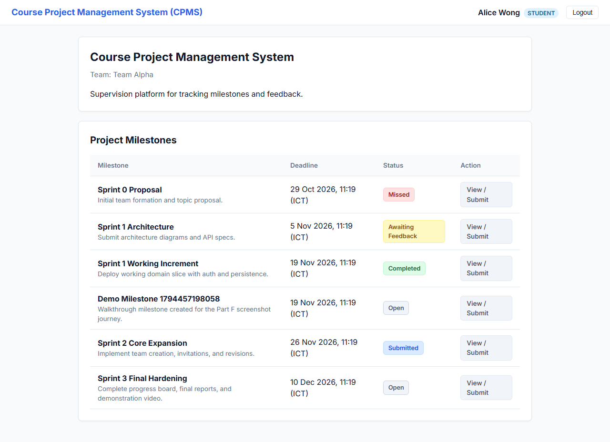

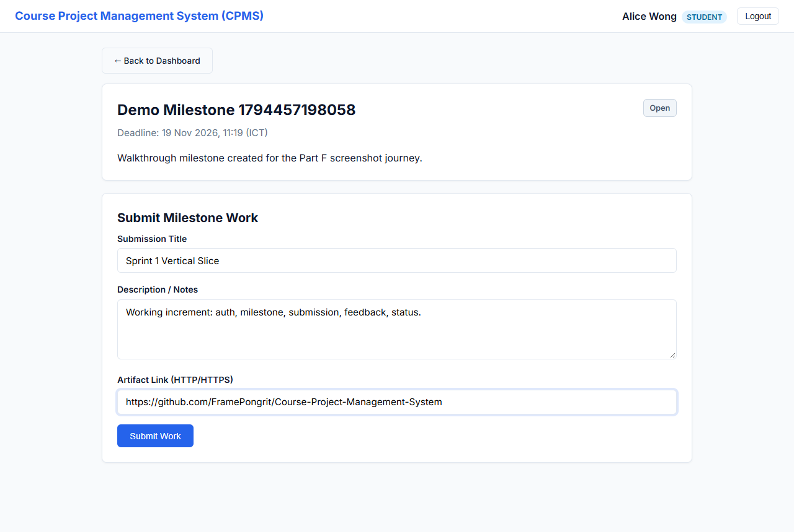

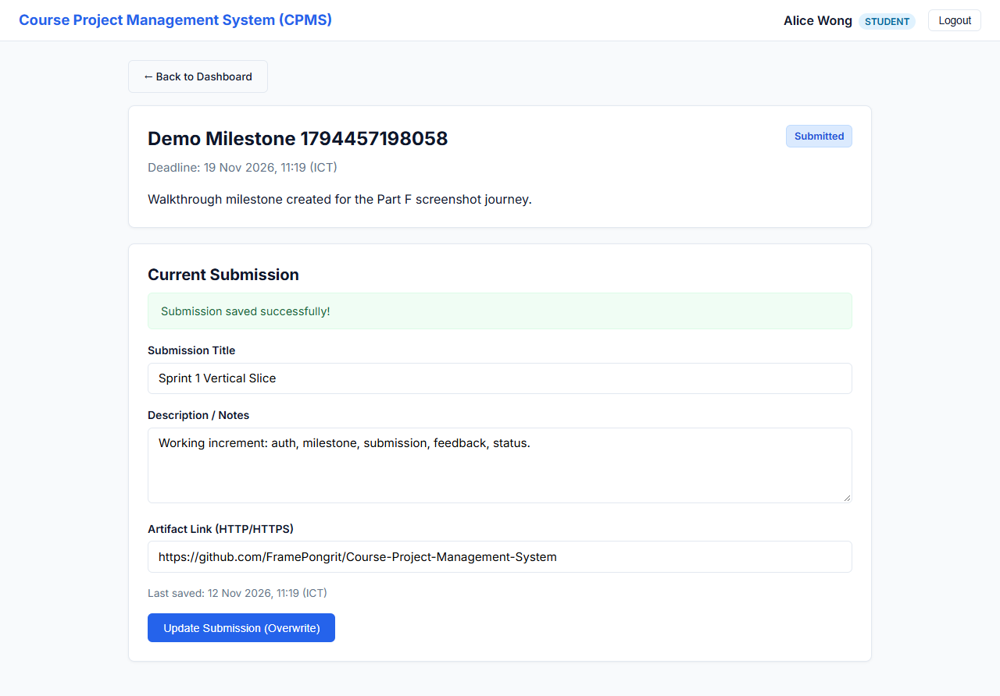

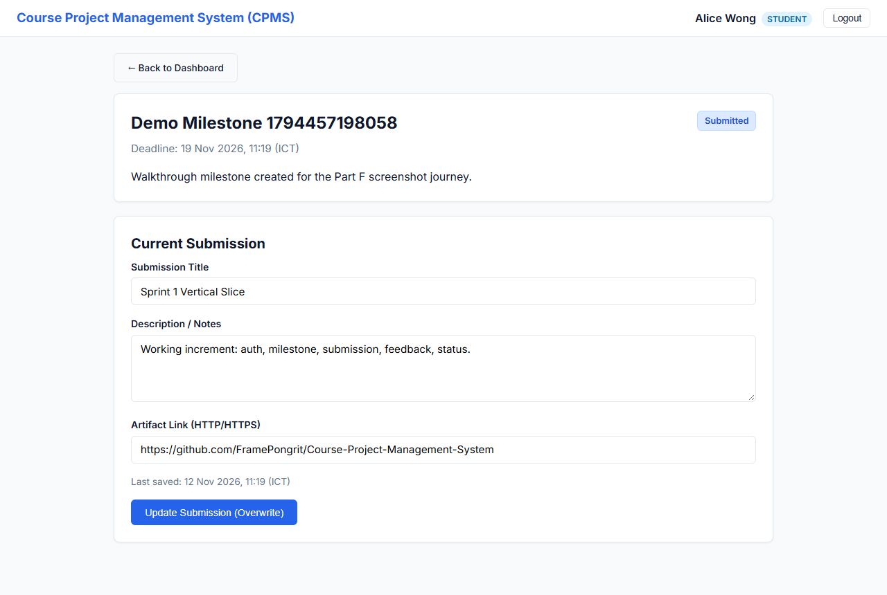

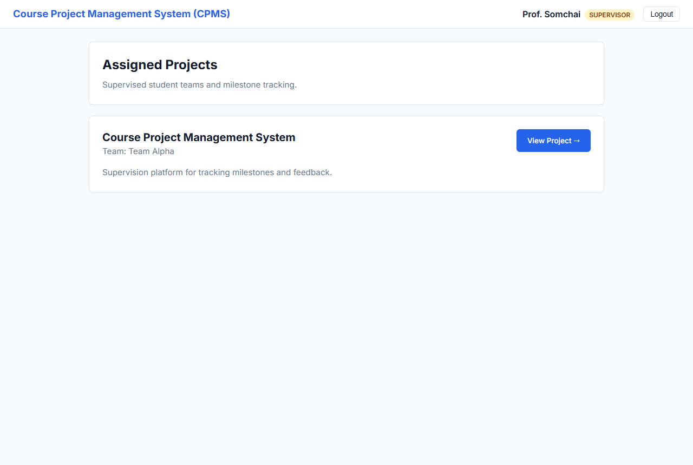

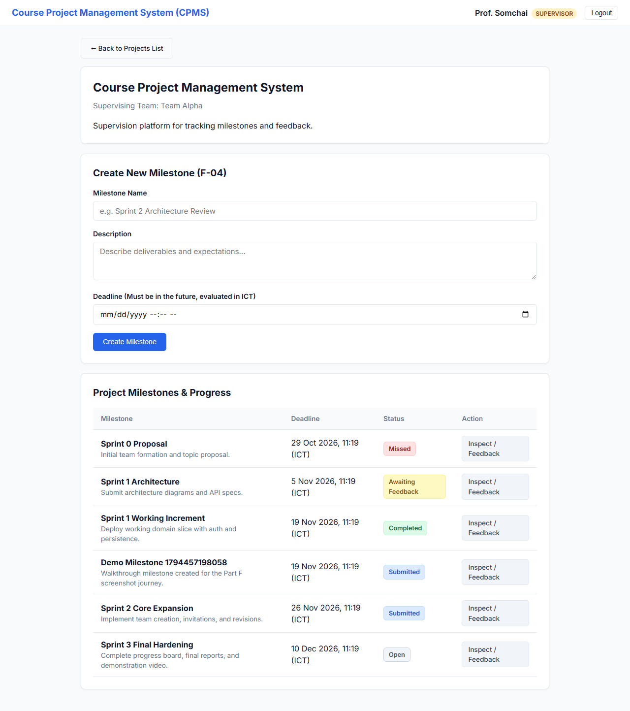

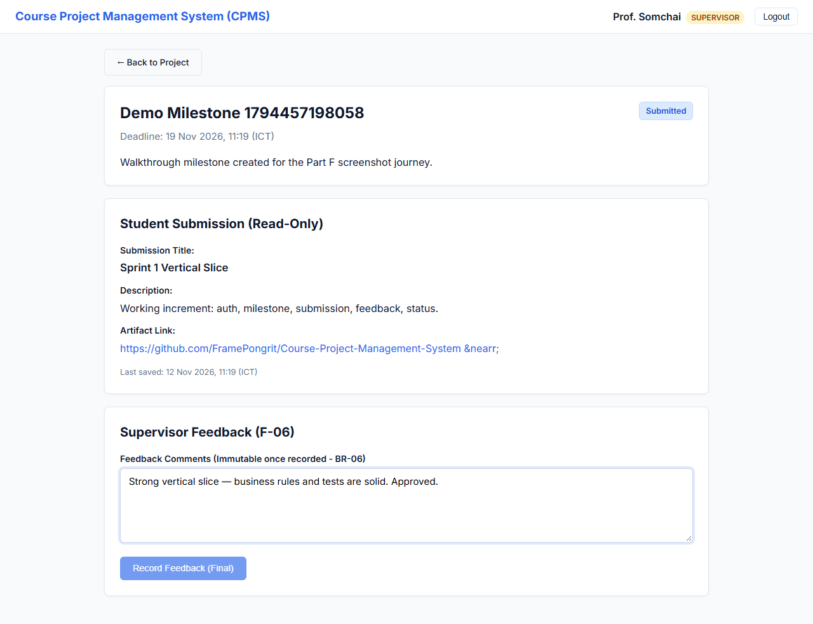

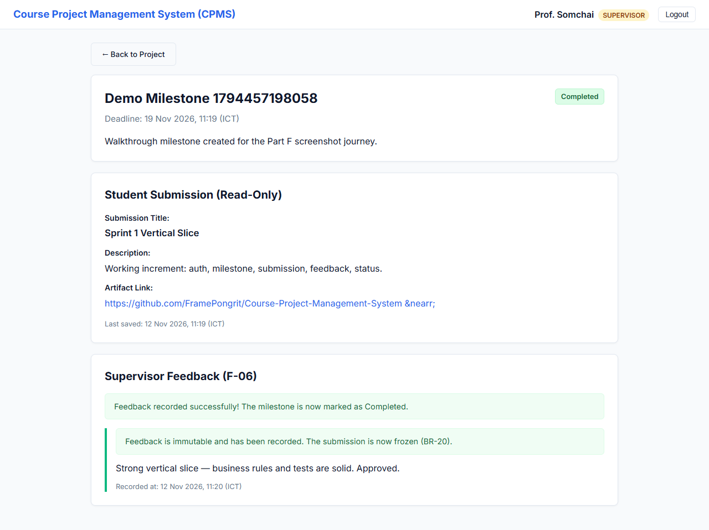

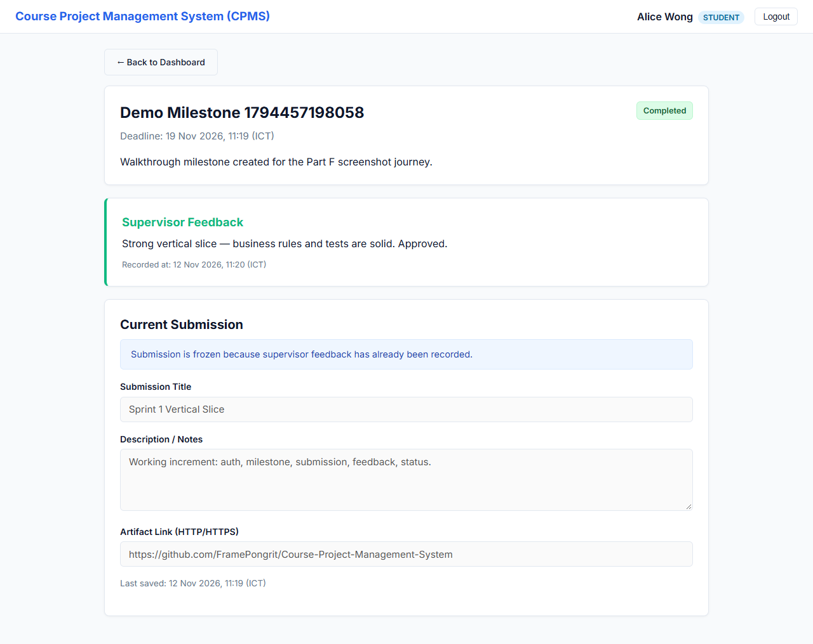

### Scenario 2 — Business-rule / cutoff rejection (BR-01)
A student opens a past-deadline milestone: the form is disabled and the cutoff banner is shown. An external `PUT …/submission` is rejected with `422 CUTOFF_PASSED` (asserted by TEST-05-03).

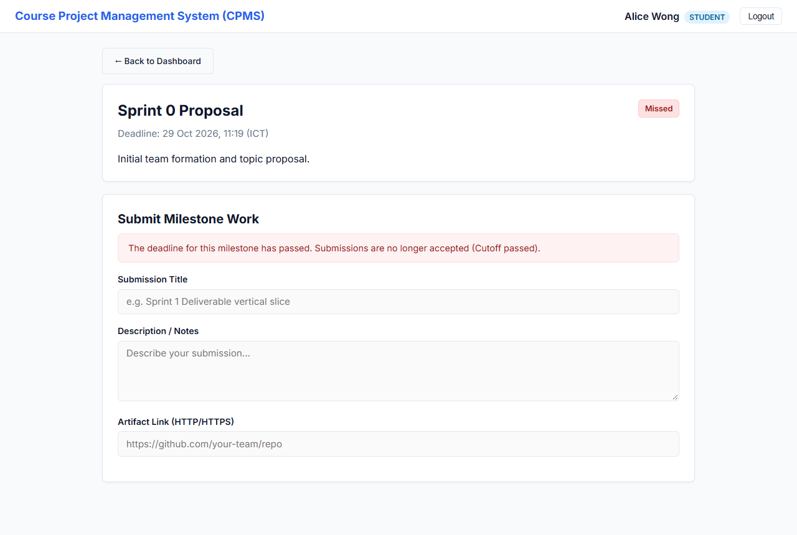

### Scenario 3 — Authorization & ownership
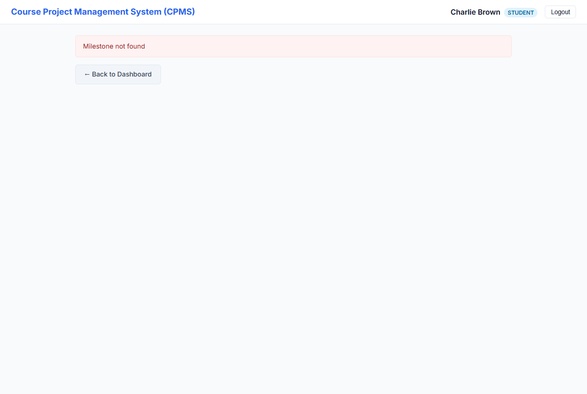

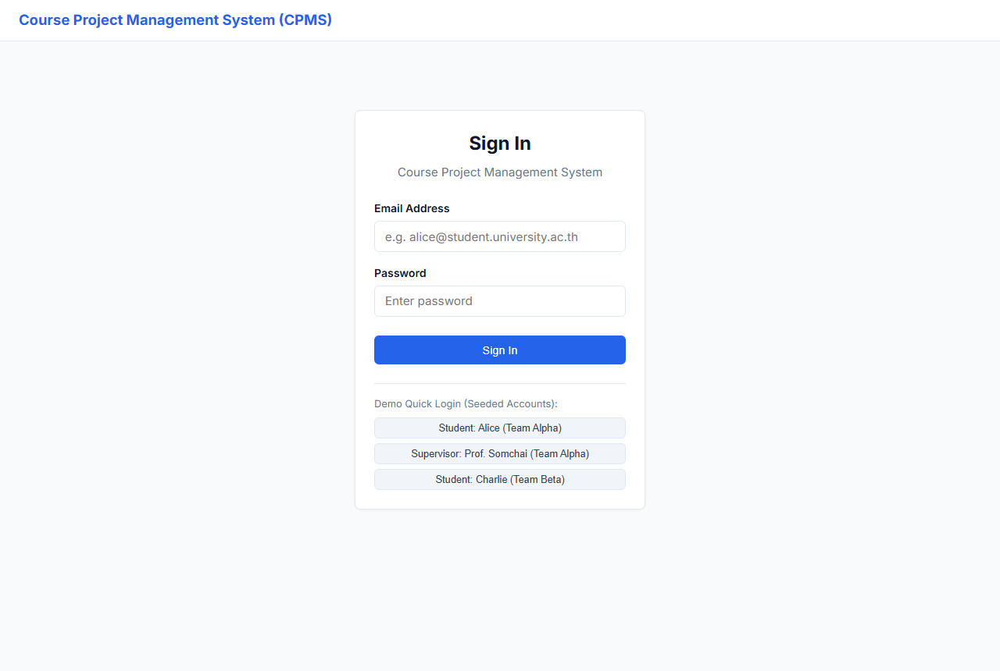

Server-side enforcement (403 role / 404 ownership / 401 unauthenticated) is proven at the API level by TEST-02-01..06, TEST-04-04, and TEST-05-06/07 (see §4 and §5).

---

## 7. Git Workflow, Issues & Review Evidence

Sprint 1 followed the course workflow: **Issue → feature branch (off `sprint-01` staging) → teammate-reviewed PR → integration → reviewed release PR to `main`.**

### Issues → feature branch → PR → integration
| Issue | Scope | Feature branch | PR | Reviewer | Merged into |
|-------|-------|----------------|----|----------|-------------|
| **#1** Authentication, Authorization Guards & Seed Data | F-01, F-02, F-03 | `01-authentication` | **PR #3** | @FramePongrit | `sprint-01` |
| **#2** Milestones, Submissions, Feedback & Progress Slice | F-04–F-08 | `01-authentication` | **PR #3** | @FramePongrit | `sprint-01` |

### Substantive review — PR #3
- **Author:** @Beethoven190 · **Reviewer:** @FramePongrit (authors do not approve their own PR).
- **Sequence:** review **COMMENTED** with specific findings → author pushed fixes → review **APPROVED** → merged into `sprint-01` (2026-11-11).
- **Findings raised and resolved:**
  1. Concurrent first-submit not atomic (race returned 409 instead of 200) → caught Prisma `P2002` and retried as update; `TEST-05-05` tightened to assert `200/200`.
  2. Dead code in the progress endpoint (unused `teamId: undefined` include) → removed.
  3. Missing UI/E2E tests and overstated coverage → added Playwright `TEST-E2E-01/02`; Part F coverage corrected.
  4. `JWT_EXPIRES_IN` not read from env → wired.

### Reviewed release to `main`
**Release PR #4** (`sprint-01 → main`) promotes the integrated increment and is tagged **`v1.0.0-sprint1`** on the merge commit on `main`.

---

## 8. Contribution Table & AI-Use Declaration

### Contribution Table
| Student | Role & Responsibilities | Deliverables |
|---------|-------------------------|--------------|
| **Pongrit Frame** | Architecture & Specifications Lead, Reviewer | Authored Parts A–E (SRS, System SDS, Feature Contracts, Traceability Matrix, Three-Sprint Plan); PR Code Reviewer & Merger. |
| **Supanut Watthanasimakorn** | Implementation & Verification Lead, Author | Implemented Part F (Backend Express API, Prisma Schema & Migrations, Seed Data, Injectable Clock, Automated Vitest Suite, React SPA Frontend, Verification Report). |

### AI-Use Declaration
AI assistant (Antigravity) was utilized as a pair-programming partner to scaffold Express routes, Prisma schema, React components, and Vitest integration suites according to the human-authored specifications and contracts in `docs/`. All design decisions, ubiquitous language, and business rules were formulated by the team. All PR reviews, approvals, and merges are exclusively performed by the team members.

---

## 9. Known Limitations & Next Steps for Sprint 2
- **Single Offering:** System models exactly one course offering (per EX-01).
- **Seeded Accounts in Sprint 1:** Account registration and team creation are introduced in Sprint 2 via Supervisor Invitations (F-09, F-10, F-11).
- **Submission History:** Sprint 1 maintains single current submission per milestone; numbered immutable revisions (F-14) will be added in Sprint 2 via additive migration M2.


\pagebreak
