# Part F — Working Sprint 1 and Verification Report
**Product:** Course Project Management System (CPMS) · Deliverable 1
**Semester:** 1/2026 · **Course:** CPE 334 Software Engineering
**Repository:** https://github.com/FramePongrit/Course-Project-Management-System
**Target Release Tag:** `v1.0.0-sprint1` on `main`

---

## 1. Team & Submission Metadata

| Field | Details |
|-------|---------|
| **Theme / Context** | Theme 6: Course Project Management System |
| **Student 1** | Supanut Watthanasimakorn (GitHub: `@Beethoven190`) |
| **Student 2** | Pongrit Frame (GitHub: `@FramePongrit`) |
| **Release Branch & Tag** | `main` / `v1.0.0-sprint1` |
| **Assessed Release** | Tag `v1.0.0-sprint1` on `main` via release PR #4 (`sprint-01 → main`); exact merge commit recorded at release (`<MERGE_COMMIT>`) |

---

## 2. Reproduction and Local Setup Summary

The application runs from documented local setup and does not require complex infrastructure.

### Prerequisites
- Node.js >= 20.x
- PostgreSQL instance running on `localhost:5432`

### Setup Commands
```bash
# 1. Clone repository
git clone https://github.com/FramePongrit/Course-Project-Management-System.git
cd Course-Project-Management-System

# 2. Configure environment variables
cp .env.example .env

# 3. Install dependencies
npm install

# 4. Run database migrations & idempotent seed
npx prisma migrate dev
npm run prisma:seed

# 5. Run automated tests (Unit, API Integration, and UI/E2E)
npm test
npm run test:e2e

# 6. Start development server (API: 8080, UI: 3000)
npm run dev

# 7. Production build & start
npm run build
npm run start
```

### Seeded Demo Accounts (Safe Handoff)
All demo accounts use synthetic data with local demo password `password123`:
- **Supervisor 1 (Prof. Somchai):** `prof.somchai@university.ac.th` (Assigned to Team Alpha / CPMS Project)
- **Supervisor 2 (Dr. Ann):** `dr.ann@university.ac.th` (Assigned to Team Beta / Smart Campus Transit)
- **Student 1 (Alice Wong, STU001):** `alice@student.university.ac.th` (Team Alpha)
- **Student 2 (Bob Smith, STU002):** `bob@student.university.ac.th` (Team Alpha)
- **Student 3 (Charlie Brown, STU003):** `charlie@student.university.ac.th` (Team Beta)
- **Student 4 (Dave Miller, STU004):** `dave@student.university.ac.th` (Status: INVITED, null password, for BR-15)

---

## 3. Automated Test Execution Results

### 3.1 Unit and API Integration Tests
**Command Executed:**
```bash
npm test (npx vitest run)
```

**Execution Output:**
```text
 RUN  v2.1.9 C:/Users/PC'M/Desktop/Course Project Management System

 ✓ tests/unit/rules.test.ts (3 tests) 5ms
 ✓ tests/unit/status.test.ts (6 tests) 5ms
 ✓ tests/unit/auth.test.ts (1 test) 304ms
 ✓ tests/api/milestones.test.ts (6 tests) 795ms
 ✓ tests/api/auth.test.ts (9 tests) 824ms
 ✓ tests/api/progress.test.ts (5 tests) 832ms
 ✓ tests/api/feedback.test.ts (7 tests) 896ms
 ✓ tests/api/submissions.test.ts (12 tests) 1109ms

 Test Files  8 passed (8)
      Tests  49 passed (49)
   Failures  0
    Skipped  0
```

### 3.2 UI / End-to-End (E2E) Critical Journeys (Playwright)
**Command Executed:**
```bash
npm run test:e2e (npm run build:client && playwright test)
```

**Execution Output:**
```text
Running 2 tests using 1 worker

  ok 1 tests\e2e\sprint1.spec.ts:48:3 › Sprint 1 UI / E2E Critical Journeys › TEST-E2E-01: Student logs in -> submits a Milestone -> reloads and sees the persisted Submission (AC-05-01, AC-05-09, AC-08-01) (1.2s)
  ok 2 tests\e2e\sprint1.spec.ts:96:3 › Sprint 1 UI / E2E Critical Journeys › TEST-E2E-02: Supervisor logs in -> records Feedback on a submitted Milestone -> status shows Completed (AC-06-01, AC-07-04) (908ms)

  2 passed (4.8s)
```

---

## 4. AC-to-Test Traceability & Execution Results Matrix

All 100% of planned Sprint 1 Acceptance Criteria are verified by executed automated tests:

| Feature | AC ID | Description | Planned Test ID | Test File & Name | Status |
|---------|-------|-------------|-----------------|------------------|:------:|
| **F-01** | AC-01-01 | Valid login -> 200 + cookie | TEST-01-01 | `tests/api/auth.test.ts` > TEST-01-01 | ✅ PASS |
| | AC-01-02 | Wrong password -> 401 generic | TEST-01-02 | `tests/api/auth.test.ts` > TEST-01-02 | ✅ PASS |
| | AC-01-03 | Unknown email -> 401 generic | TEST-01-03 | `tests/api/auth.test.ts` > TEST-01-03 | ✅ PASS |
| | AC-01-04 | GET /me with session -> 200 user | TEST-01-04 | `tests/api/auth.test.ts` > TEST-01-04 | ✅ PASS |
| | AC-01-05 | GET /me without session -> 401 | TEST-01-05 | `tests/api/auth.test.ts` > TEST-01-05 | ✅ PASS |
| | AC-01-06 | Logout clears cookie -> 204 then 401 | TEST-01-06 | `tests/api/auth.test.ts` > TEST-01-06 | ✅ PASS |
| | AC-01-07 | INVITED account cannot login (BR-15) | TEST-01-07 | `tests/api/auth.test.ts` > TEST-01-07 | ✅ PASS |
| | AC-01-08 | Hashing cost >= 10, not plaintext | TEST-01-09 | `tests/unit/auth.test.ts` > TEST-01-09 | ✅ PASS |
| | AC-01-09 | Duplicate email rejected by DB (BR-14) | TEST-01-08 | `tests/api/auth.test.ts` > TEST-01-08 | ✅ PASS |
| **F-02** | AC-02-01 | Unauthenticated calls return 401 (NFR-01) | TEST-02-01 | `tests/api/auth.test.ts` > TEST-02-01 | ✅ PASS |
| | AC-02-02 | Student A requests Student B data -> 404 | TEST-02-02 | `tests/api/progress.test.ts` > TEST-08-04 | ✅ PASS |
| | AC-02-03 | Student attempts Supervisor write -> 403 | TEST-02-03 | `tests/api/milestones.test.ts` > TEST-04-04 | ✅ PASS |
| | AC-02-04 | Supervisor requests unassigned team -> 404 | TEST-02-04 | `tests/api/progress.test.ts` > TEST-08-04 | ✅ PASS |
| | AC-02-05 | Supervisor attempts Student write -> 403 | TEST-02-05 | `tests/api/submissions.test.ts` > TEST-05-07 | ✅ PASS |
| | AC-02-06 | Client-forged identity in body ignored (BR-17) | TEST-02-06 | `tests/api/submissions.test.ts` > TEST-02-06 | ✅ PASS |
| **F-04** | AC-04-01 | Supervisor creates milestone -> 201 + GET | TEST-04-01 | `tests/api/milestones.test.ts` > TEST-04-01 | ✅ PASS |
| | AC-04-02 | Past/now deadline rejected (BR-03) | TEST-04-02 | `tests/api/milestones.test.ts` > TEST-04-02 | ✅ PASS |
| | AC-04-03 | Duplicate milestone name rejected (BR-04) | TEST-04-03 | `tests/api/milestones.test.ts` > TEST-04-03 | ✅ PASS |
| | AC-04-04 | Student milestone creation -> 403 | TEST-04-04 | `tests/api/milestones.test.ts` > TEST-04-04 | ✅ PASS |
| | AC-04-05 | Unassigned supervisor creation -> 404 | TEST-04-05 | `tests/api/milestones.test.ts` > TEST-04-05 | ✅ PASS |
| | AC-04-06 | S1 milestone immutable (no PUT/DELETE) | TEST-04-06 | `tests/api/milestones.test.ts` > TEST-04-06 | ✅ PASS |
| **F-05** | AC-05-01 | First submit before deadline -> 200 + audit | TEST-05-01 | `tests/api/submissions.test.ts` > TEST-05-01 | ✅ PASS |
| | AC-05-02 | Overwrite before deadline -> 200, last audit | TEST-05-02 | `tests/api/submissions.test.ts` > TEST-05-02 | ✅ PASS |
| | AC-05-03 | Submit after deadline -> 422 CUTOFF_PASSED | TEST-05-03 | `tests/api/submissions.test.ts` > TEST-05-03 | ✅ PASS |
| | AC-05-04 | Empty title or bad link -> 422 | TEST-05-04 | `tests/api/submissions.test.ts` > TEST-05-04 | ✅ PASS |
| | AC-05-05 | Concurrent first-submits -> one row (BR-02) | TEST-05-05 | `tests/api/submissions.test.ts` > TEST-05-05 | ✅ PASS |
| | AC-05-06 | Other-team student submit -> 404 | TEST-05-06 | `tests/api/submissions.test.ts` > TEST-05-06 | ✅ PASS |
| | AC-05-07 | Supervisor submit -> 403 | TEST-05-07 | `tests/api/submissions.test.ts` > TEST-05-07 | ✅ PASS |
| | AC-05-08 | No delete endpoint for submission (BR-07) | TEST-05-08 | `tests/api/submissions.test.ts` > TEST-05-08 | ✅ PASS |
| | AC-05-09 | GET submission retrieves current record | TEST-05-09 | `tests/api/submissions.test.ts` > TEST-05-09 | ✅ PASS |
| | AC-05-10 | Overwrite after feedback -> 409 (BR-20) | TEST-05-11 | `tests/api/submissions.test.ts` > TEST-05-11 | ✅ PASS |
| **F-06** | AC-06-01 | Supervisor records feedback -> 201 | TEST-06-01 | `tests/api/feedback.test.ts` > TEST-06-01 | ✅ PASS |
| | AC-06-02 | Feedback before deadline -> Completed (D-03) | TEST-06-02 | `tests/api/feedback.test.ts` > TEST-06-02 | ✅ PASS |
| | AC-06-03 | Feedback without submission -> 422 (BR-05) | TEST-06-03 | `tests/api/feedback.test.ts` > TEST-06-03 | ✅ PASS |
| | AC-06-04 | Second feedback -> 409 CONFLICT (BR-06) | TEST-06-04 | `tests/api/feedback.test.ts` > TEST-06-04 | ✅ PASS |
| | AC-06-05 | Student feedback attempt -> 403 | TEST-06-05 | `tests/api/feedback.test.ts` > TEST-06-05 | ✅ PASS |
| | AC-06-06 | Unassigned supervisor feedback -> 404 | TEST-06-06 | `tests/api/feedback.test.ts` > TEST-06-06 | ✅ PASS |
| | AC-06-07 | View feedback (member/sup=200, other=404) | TEST-06-07 | `tests/api/feedback.test.ts` > TEST-06-07 | ✅ PASS |
| | AC-06-08 | Feedback bound to submissionId (BR-18) | TEST-06-08 | `tests/api/feedback.test.ts` > TEST-06-01 | ✅ PASS |
| **F-07** | AC-07-01 | Open status (!sub && !past) | TEST-07-01 | `tests/unit/status.test.ts` > TEST-07-01 | ✅ PASS |
| | AC-07-02 | Submitted status (sub && !fb && !past) | TEST-07-02 | `tests/unit/status.test.ts` > TEST-07-02 | ✅ PASS |
| | AC-07-03 | Awaiting Feedback status (sub && !fb && past) | TEST-07-03 | `tests/unit/status.test.ts` > TEST-07-03 | ✅ PASS |
| | AC-07-04 | Completed status (fb exists) | TEST-07-04 | `tests/unit/status.test.ts` > TEST-07-04 | ✅ PASS |
| | AC-07-05 | Missed status (!sub && past) | TEST-07-05 | `tests/unit/status.test.ts` > TEST-07-05 | ✅ PASS |
| | AC-07-06 | Read-only derived, no client setter | TEST-07-06 | `tests/unit/status.test.ts` & API inspection | ✅ PASS |
| | AC-07-07 | Clock advances across deadline transitions | TEST-07-07 | `tests/unit/status.test.ts` > TEST-07-07 | ✅ PASS |
| **F-08** | AC-08-01 | Student views progress with derived status | TEST-08-01 | `tests/api/progress.test.ts` > TEST-08-01 | ✅ PASS |
| | AC-08-02 | Assigned supervisor views same progress | TEST-08-02 | `tests/api/progress.test.ts` > TEST-08-02 | ✅ PASS |
| | AC-08-03 | No numeric percentage/score (EX-05) | TEST-08-03 | `tests/api/progress.test.ts` > TEST-08-03 | ✅ PASS |
| | AC-08-04 | Cross-scope progress access returns 404 | TEST-08-04 | `tests/api/progress.test.ts` > TEST-08-04 | ✅ PASS |
| **UI / E2E** | AC-05-01, AC-05-09, AC-08-01 | Student logs in -> submits -> reloads and sees persisted Submission | TEST-E2E-01 | `tests/e2e/sprint1.spec.ts` > TEST-E2E-01 | ✅ PASS |
| **UI / E2E** | AC-06-01, AC-07-04 | Supervisor logs in -> records Feedback -> status shows Completed | TEST-E2E-02 | `tests/e2e/sprint1.spec.ts` > TEST-E2E-02 | ✅ PASS |

---

## 5. Excerpts of Automated Tests (Required by Rubric)

### Excerpt 1: Domain Rule Enforcement (BR-01 Cutoff & BR-20 Post-Feedback Freeze)
*Source: `tests/api/submissions.test.ts`*
```typescript
// Excerpt from TEST-05-03: Cutoff past deadline rejection
it("TEST-05-03: submitting when clock past deadline -> 422 CUTOFF_PASSED (AC-05-03, BR-01)", async () => {
  const res = await request(app)
    .put(`/api/milestones/${pastMilestoneId}/submission`)
    .set("Cookie", aliceCookie)
    .send({
      title: "Late Submission",
      description: "Late submit attempt",
      link: "https://github.com/example/repo/pull/99",
    });

  expect(res.status).toBe(422);
  expect(res.body.error.code).toBe("CUTOFF_PASSED");
});

// Excerpt from TEST-05-11: Freeze submission after feedback recorded
it("TEST-05-11: overwrite after Feedback recorded is rejected -> 409 FEEDBACK_RECORDED (AC-05-10, BR-20)", async () => {
  const res = await request(app)
    .put(`/api/milestones/${completedMilestoneId}/submission`)
    .set("Cookie", aliceCookie)
    .send({
      title: "Attempt overwrite after feedback",
      description: "Should fail with 409",
      link: "https://github.com/example/fail",
    });

  expect(res.status).toBe(409);
  expect(res.body.error.code).toBe("FEEDBACK_RECORDED");
});
```

### Excerpt 2: Role & Ownership Restriction Enforcement (BR-17, NFR-01, NFR-02)
*Source: `tests/api/submissions.test.ts` & `tests/api/milestones.test.ts`*
```typescript
// Excerpt from TEST-05-06: Cross-team data isolation
it("TEST-05-06: student of another team cannot submit -> 404 (AC-05-06)", async () => {
  // Charlie belongs to Team Beta; testMilestoneId belongs to Team Alpha
  const res = await request(app)
    .put(`/api/milestones/${testMilestoneId}/submission`)
    .set("Cookie", charlieCookie)
    .send({
      title: "Charlie Intrusion",
      description: "Intruder",
      link: "https://github.com/intruder",
    });

  expect(res.status).toBe(404);
  expect(res.body.error.code).toBe("NOT_FOUND");
});

// Excerpt from TEST-04-04: Role protection (Students cannot create Milestones)
it("TEST-04-04: student attempts to create milestone -> 403 FORBIDDEN (AC-04-04)", async () => {
  const res = await request(app)
    .post(`/api/projects/${project1Id}/milestones`)
    .set("Cookie", studentCookie)
    .send({
      name: "Student Attempt",
      description: "Should be forbidden",
      deadline: "2026-11-25T12:00:00.000Z",
    });

  expect(res.status).toBe(403);
  expect(res.body.error.code).toBe("FORBIDDEN");
});
```

---

## 6. Program Demonstrations (Screenshots)

Captured automatically via Playwright (`npm run screenshots` — see `docs/screenshots/README.md`); each image is a real render of the running application against the seeded PostgreSQL database. Backend/API proof for the protected operations is additionally given by the automated test excerpts (§5) and the AC matrix (§4): a UI screenshot alone does not establish backend authorization.

### Scenario 1 — Normal domain journey + persisted retrieval
Student `alice@student.university.ac.th` logs in and submits milestone work; supervisor `prof.somchai@university.ac.th` records feedback. Status transitions Open → Submitted → Completed and the saved data survives a page reload.


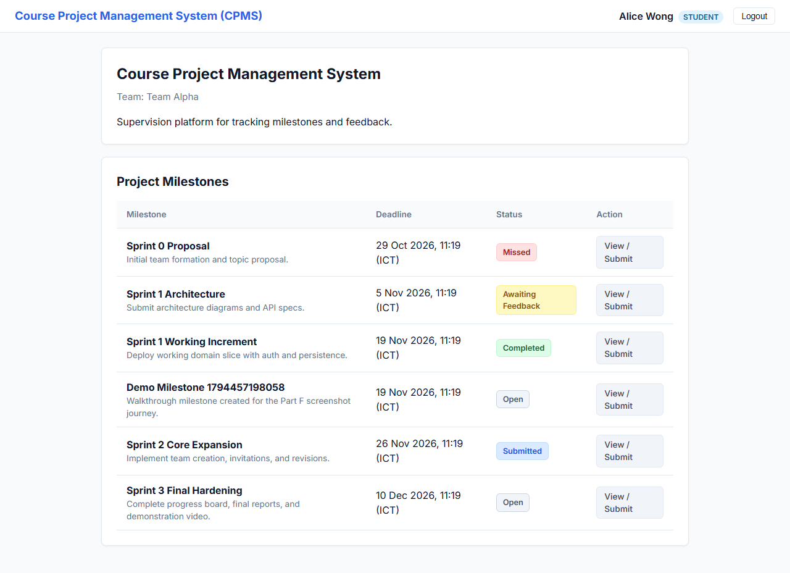

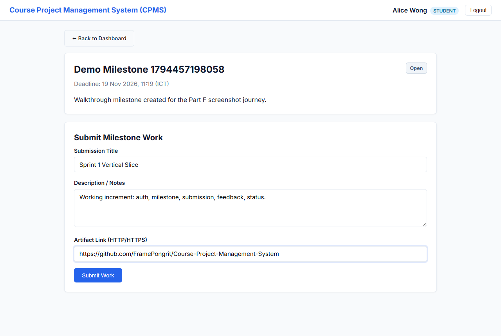

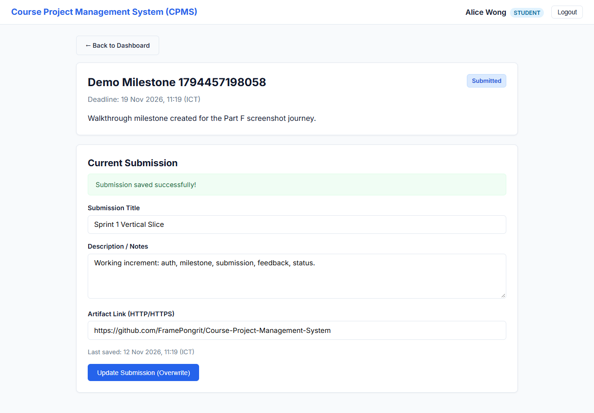

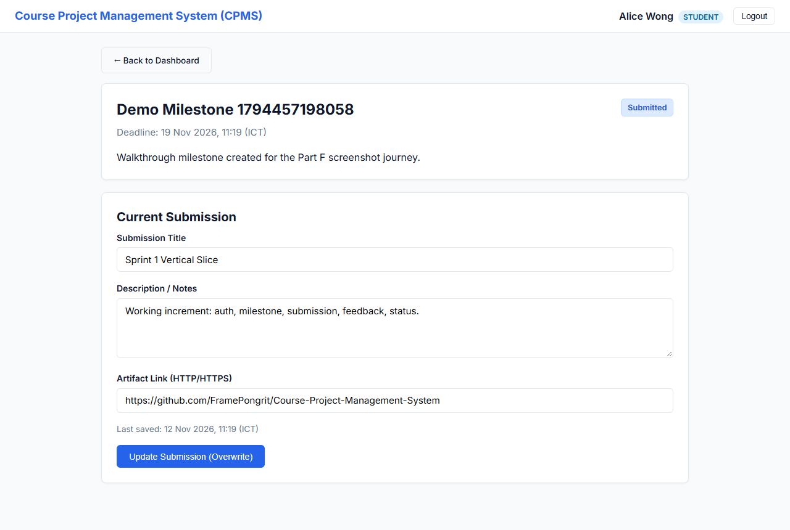

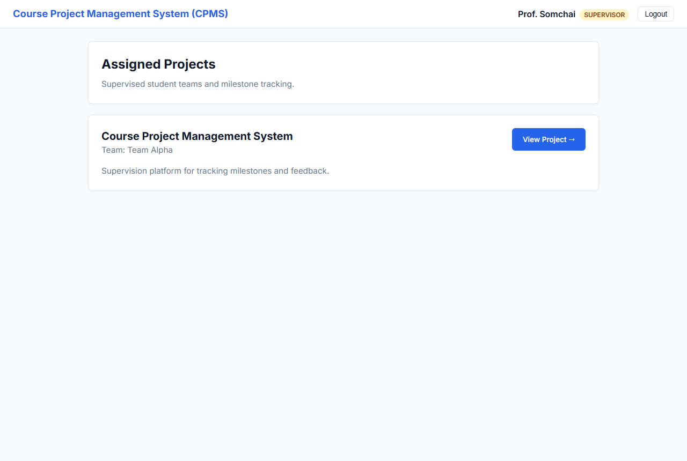

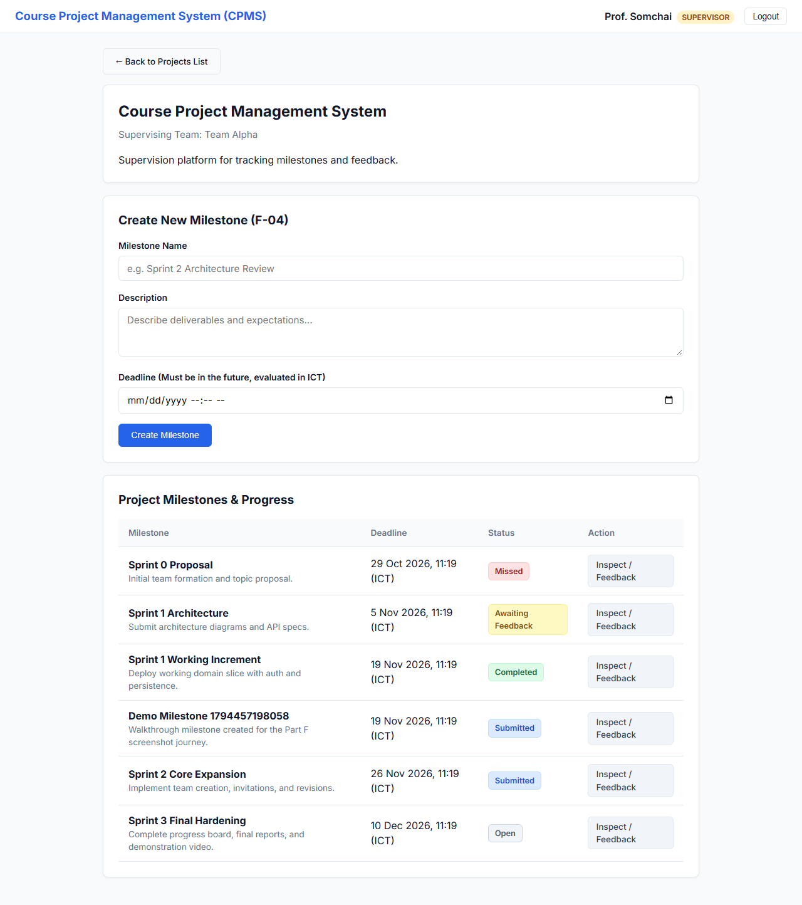

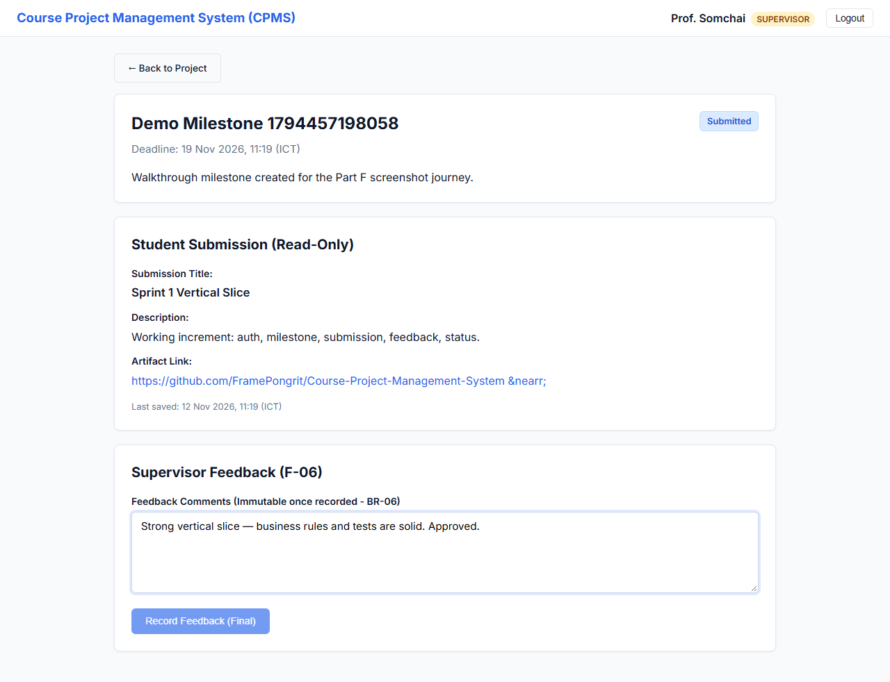

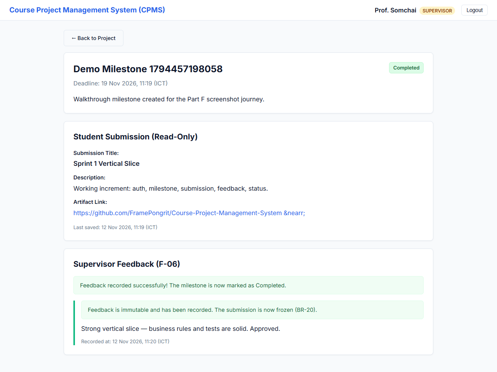

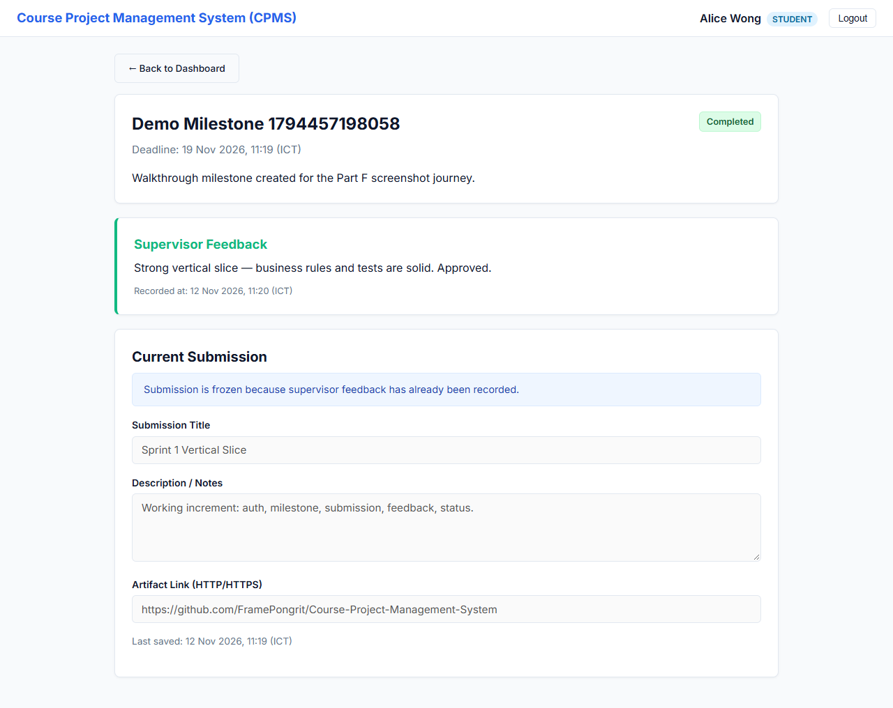

### Scenario 2 — Business-rule / cutoff rejection (BR-01)
A student opens a past-deadline milestone: the form is disabled and the cutoff banner is shown. An external `PUT …/submission` is rejected with `422 CUTOFF_PASSED` (asserted by TEST-05-03).

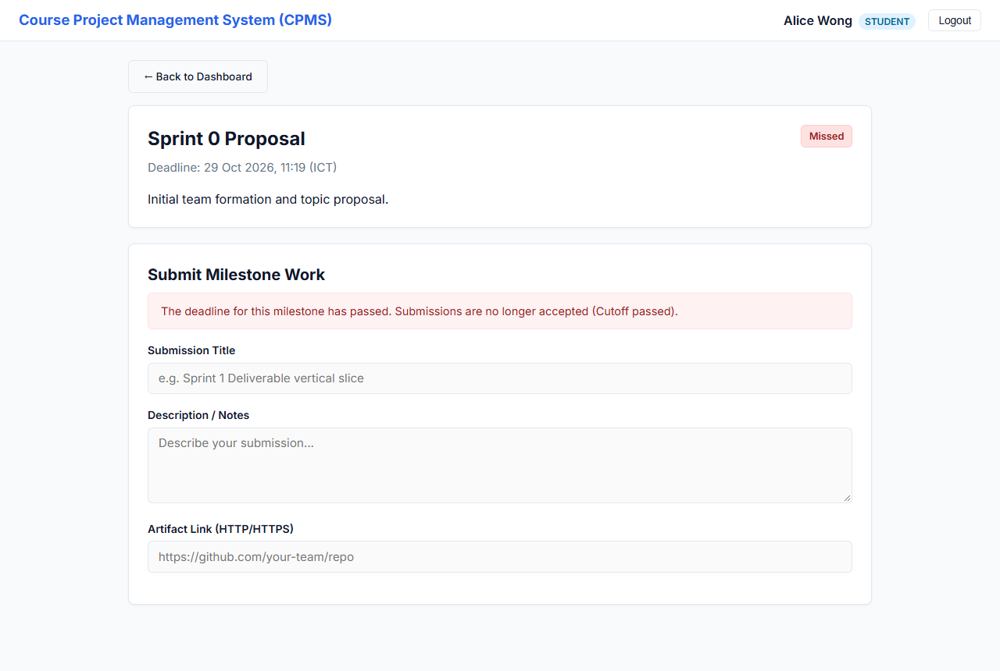

### Scenario 3 — Authorization & ownership
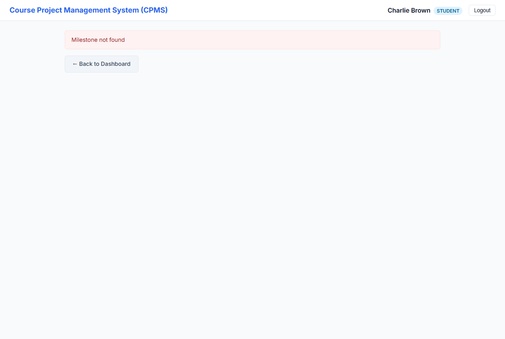

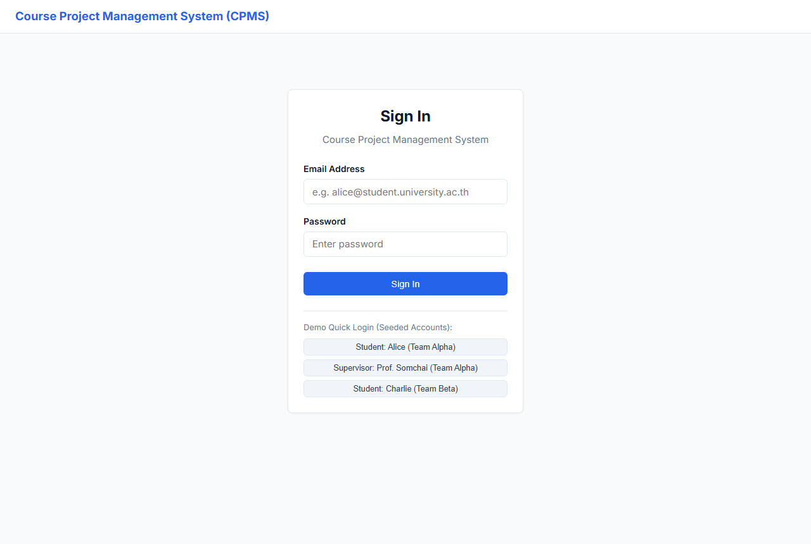

Server-side enforcement (403 role / 404 ownership / 401 unauthenticated) is proven at the API level by TEST-02-01..06, TEST-04-04, and TEST-05-06/07 (see §4 and §5).

---

## 7. Git Workflow, Issues & Review Evidence

Sprint 1 followed the course workflow: **Issue → feature branch (off `sprint-01` staging) → teammate-reviewed PR → integration → reviewed release PR to `main`.**

### Issues → feature branch → PR → integration
| Issue | Scope | Feature branch | PR | Reviewer | Merged into |
|-------|-------|----------------|----|----------|-------------|
| **#1** Authentication, Authorization Guards & Seed Data | F-01, F-02, F-03 | `01-authentication` | **PR #3** | @FramePongrit | `sprint-01` |
| **#2** Milestones, Submissions, Feedback & Progress Slice | F-04–F-08 | `01-authentication` | **PR #3** | @FramePongrit | `sprint-01` |

### Substantive review — PR #3
- **Author:** @Beethoven190 · **Reviewer:** @FramePongrit (authors do not approve their own PR).
- **Sequence:** review **COMMENTED** with specific findings → author pushed fixes → review **APPROVED** → merged into `sprint-01` (2026-11-11).
- **Findings raised and resolved:**
  1. Concurrent first-submit not atomic (race returned 409 instead of 200) → caught Prisma `P2002` and retried as update; `TEST-05-05` tightened to assert `200/200`.
  2. Dead code in the progress endpoint (unused `teamId: undefined` include) → removed.
  3. Missing UI/E2E tests and overstated coverage → added Playwright `TEST-E2E-01/02`; Part F coverage corrected.
  4. `JWT_EXPIRES_IN` not read from env → wired.

### Reviewed release to `main`
**Release PR #4** (`sprint-01 → main`) promotes the integrated increment and is tagged **`v1.0.0-sprint1`** on the merge commit on `main`.

---

## 8. Contribution Table & AI-Use Declaration

### Contribution Table
| Student | Role & Responsibilities | Deliverables |
|---------|-------------------------|--------------|
| **Pongrit Frame** | Architecture & Specifications Lead, Reviewer | Authored Parts A–E (SRS, System SDS, Feature Contracts, Traceability Matrix, Three-Sprint Plan); PR Code Reviewer & Merger. |
| **Supanut Watthanasimakorn** | Implementation & Verification Lead, Author | Implemented Part F (Backend Express API, Prisma Schema & Migrations, Seed Data, Injectable Clock, Automated Vitest Suite, React SPA Frontend, Verification Report). |

### AI-Use Declaration
AI assistant (Antigravity) was utilized as a pair-programming partner to scaffold Express routes, Prisma schema, React components, and Vitest integration suites according to the human-authored specifications and contracts in `docs/`. All design decisions, ubiquitous language, and business rules were formulated by the team. All PR reviews, approvals, and merges are exclusively performed by the team members.

---

## 9. Known Limitations & Next Steps for Sprint 2
- **Single Offering:** System models exactly one course offering (per EX-01).
- **Seeded Accounts in Sprint 1:** Account registration and team creation are introduced in Sprint 2 via Supervisor Invitations (F-09, F-10, F-11).
- **Submission History:** Sprint 1 maintains single current submission per milestone; numbered immutable revisions (F-14) will be added in Sprint 2 via additive migration M2.

